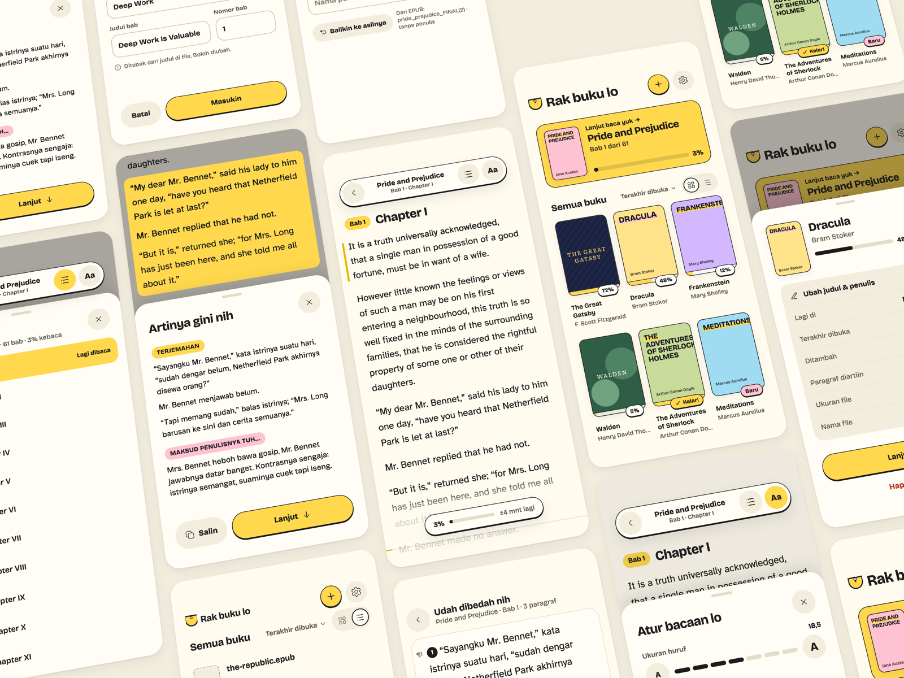
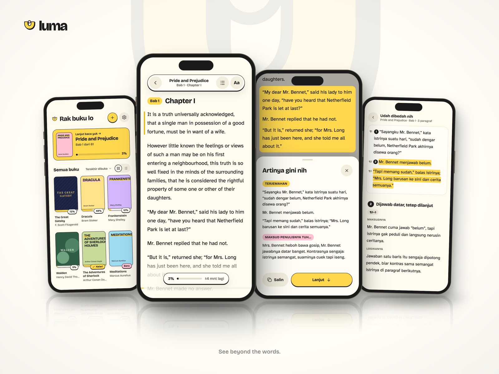
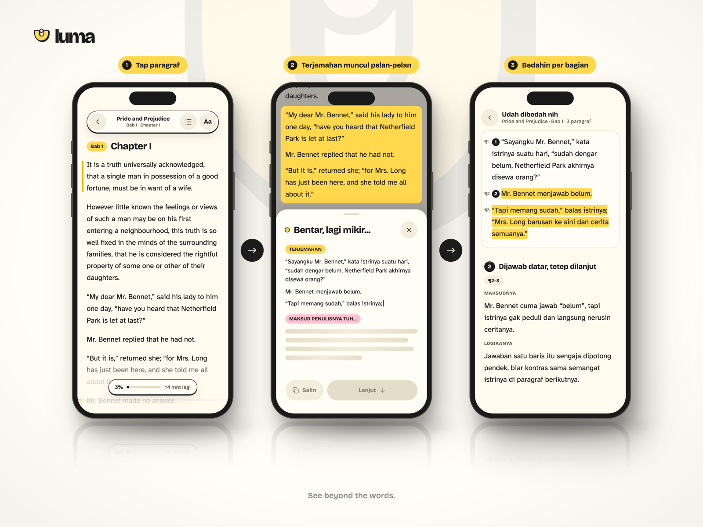
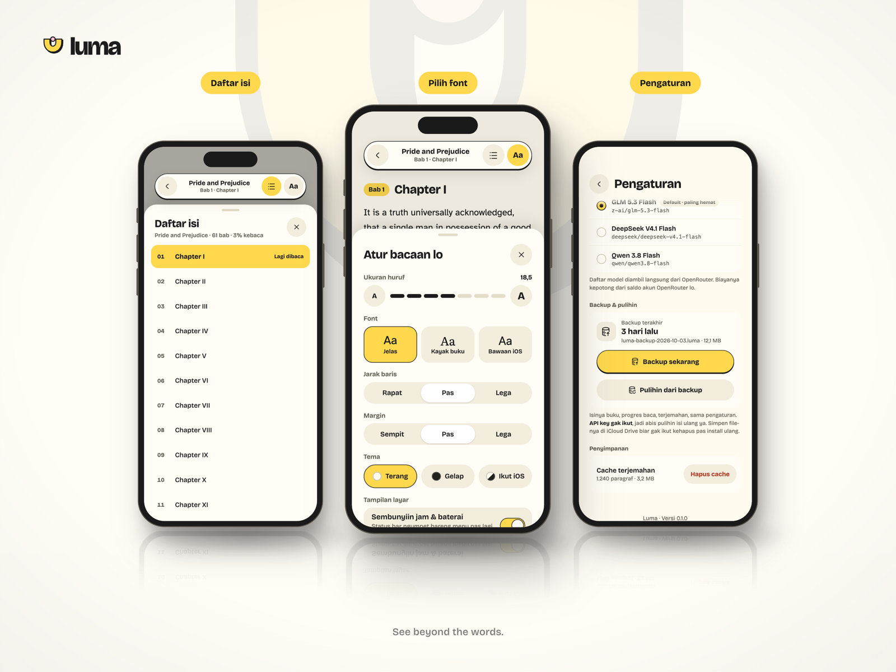

<p align="center">
  <picture>
    <source media="(prefers-color-scheme: dark)" srcset="apps/mobile/assets/brand/logo-lockup-dark.svg">
    
  </picture>
</p>

<p align="center">
  A book reader for iOS and Android with an AI that has read the book. Tap a paragraph for an Indonesian translation and what it means, or ask about the whole book and get answers cited from its pages.
</p>

<div align="center">
  

<details>
<summary>More screens</summary>
<br>
  
  <br><br>
  
  <br><br>
  
</details>
</div>

No more copying paragraphs into a chatbot that hasn't read your book, then hunting for your place again: the explanation sits next to the text, and the AI answers from the book itself.

## Talk to your book

*Ngobrolin buku* is a chat that reads the book with you. Ask "why did she refuse him?" or "what does the author mean by virtue here?" and it:

- plans what to read: the current chapter, specific chapters from the real table of contents, or a search for a concept across the whole book;
- answers with citations, each one a tap away from the exact passage, without losing your reading position;
- shows its steps as it works (reading, searching, writing) and keeps notes per chapter so later questions are faster;
- knows where you are in the book and can start from a quote you highlighted.

## Features

- **Read:** distraction-free reader with font, size, spacing and light/dark themes; full-text search inside a book.
- **Understand:** *Artinya* (translation + meaning per paragraph, streamed) and *Bedahin* (breaks an idea into parts and links them to the rest of the book).
- **Collect:** import EPUB, Markdown and PDF; find and download public-domain books from Project Gutenberg.
- **Keep:** local-first library, backup to a `.zip` or the cloud, sync between devices. UI in Indonesian or English.

## Data and privacy

Your library lives on the device (SQLite via Drift). AI requests go straight from the device to [OpenRouter](https://openrouter.ai), with either your own API key or a free quota tied to your account. An account (invite-only for now) enables cloud backup and sync through a small Cloudflare Worker; API keys stay in the device's secure storage and are never backed up.

## Repo

| Path | What |
|---|---|
| `apps/mobile` | Flutter app (Riverpod, Drift, go_router) |
| `apps/backend` | Cloudflare Worker: Hono, D1, R2, Better Auth |
| `docs/` | Product and technical docs, in Indonesian ([index](docs/README.md)) |

## Getting started

Needs Flutter via [FVM](https://fvm.app), Xcode and/or the Android SDK, and [Bun](https://bun.sh) for the backend.

```bash
make get            # pub get
make gen            # codegen (Drift, freezed)
make run f=dev      # debug build of Luma Dev on a device / simulator
make check          # format, analyze, test

make backend-install
make backend-dev    # local Worker on :8787
make backend-test

make help           # every command
```

Backend accounts, secrets and deploys: [docs/backend.md](docs/backend.md) (Setup & deploy).

## Builds

Two apps with separate data: **Luma Dev** (`make dev`, `make dev-android`) from any branch, and **Luma** (`make release`, `make release-android`, `make apk`) from `master` only.

Android release signing uses a fixed keystore kept outside the repo:

```bash
keytool -genkeypair -v -keystore ~/.android/luma-release.jks -alias luma \
  -keyalg RSA -keysize 2048 -validity 10000
```

Then create `apps/mobile/android/key.properties` (gitignored) with `storeFile`, `storePassword`, `keyAlias=luma` and `keyPassword`.
