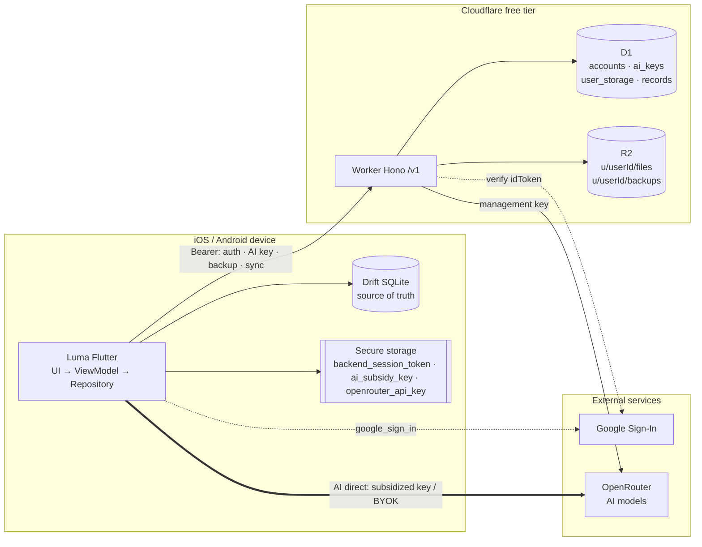
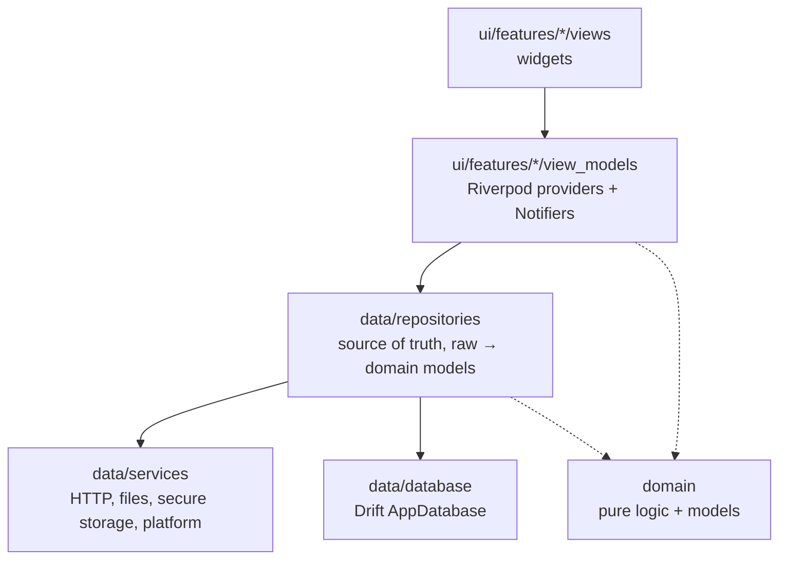

# Mobile architecture

How the Flutter app in `apps/mobile` is put together: layers, where code lives, the main runtime flows, and the rules that keep them safe. Feature behavior, tables, and prompts live in their own docs (linked per section). Paths are relative to `apps/mobile/lib`.

## Overview

Luma is local-first: the Drift database on the device is the source of truth, and every feature works offline except AI calls, Discover's network fetches (first catalog download, popular feed, book details and EPUB downloads; catalog search works offline once downloaded), and the optional backend (accounts, subsidized AI key, cloud backup, sync; see [backend.md](backend.md)).

AI requests go straight from the app to OpenRouter with the user's key (own or subsidized); the backend never proxies them.

## Layers

Rules:

- `domain/` imports no Flutter, Drift, `data/`, or `ui/`. It holds pure logic (grouping, parsers, prompts, chat retrieval/budget/preview, reading percentage) and immutable models, so it is tested with plain `test()`.
- Views go through providers: mostly view models, sometimes a repository provider directly (e.g. settings screens). Repositories never import `ui/`.
- UI never touches `appDatabaseProvider`, except `BackupView` invalidating it after a restore, because the restore closes and swaps the database file (see [Restore swaps the database](#restore-swaps-the-database)).
- Repositories own the Drift queries and writes. Services are adapters (HTTP, files, platform); only `BackupService` and `RestoreService` touch the database file directly, to snapshot and swap it.

## Code map

- `main.dart`: bootstraps the `ProviderScope`, opens the router, wraps the app in `SyncTrigger`.
- `routing/router.dart`: `routerProvider`, the `Routes` constants, and `authRedirect`.
- `data/database/`: `AppDatabase` (tables, `schemaVersion`, `onCreate`/`onUpgrade`, FTS triggers, `contentChanged`), `appDatabaseProvider`, and `sync_schema.dart` (which tables sync, outbox triggers). Table reference: [data-model.md](data-model.md).
- `data/repositories/`: one repository per area (books, import, reading progress, AI results, breakdowns, settings, search, catalog, auth, AI key, cloud backup, sync, chat). The chat area is split into `ChatRepository` (persistence), `ChatContextRepository` (retrieval + transport), `chat_snapshot.dart` (row ↔ model mapping), `ChatIndexRepository`, and `ChatNotesRepository`.
- `data/services/`: `OpenRouterService`, `BackendClient` and the backend services (auth, AI key, sync, cloud backup), `EpubParser` + `ChapterExtractor`, `PdfService`, `BackupService` / `RestoreService`, `FileStorage`, `ApiKeyStore` / `SessionStore` (secure storage), `GutenbergSource` (`BookSource`), `ChatLifecycle`, share, notifications, file picker.
- `domain/`: pure logic and `domain/models/` (freezed or plain immutable classes); `domain/catalog/` parses the Gutenberg OPDS / catalog feed.
- `ui/core/`: Stabilo theme (`theme/`, tokens in `stabilo_tokens.dart`) and shared widgets (`widgets/`).
- `ui/features/<feature>/{views,view_models}/`: `auth`, `bookshelf`, `breakdown` (Bedahin screen), `chat` (Ngobrolin buku), `discover` (Cari buku), `import_book`, `reader` (also owns the Artinya, Bedahin, and Cari kata view models), `settings` (also hosts `SyncTrigger`), `shell` (`AppShell` + `LumaNavBar`), `splash`.
- `l10n/`: ARB files and generated localizations ([i18n.md](i18n.md)).

## State management

- Riverpod 3 with hand-written providers declared next to the class they expose. A `Notifier` is the view model.
- `.autoDispose` for per-screen state; repositories, services, and the database live for the app's lifetime. Long-lived chat pieces (`chatRepositoryProvider`, `chatContextRepositoryProvider`, `chatLifecycleProvider`) are deliberately not autoDispose.
- Per-item state uses `.family` keyed by records with value equality, e.g. `GroupRef = ({int chapterId, int groupIndex})`.
- Paid AI providers disable Riverpod's automatic retry (`retry: (_, _) => null`): every attempt costs money. Retrying after a failure is always an explicit user action (`ref.invalidate`); the only automatic extra calls are bounded repairs of an invalid answer (Artinya once, chat at most 2; see [llm.md](llm.md)).
- `appDatabaseProvider` throws under `flutter test`, so widget tests must override every provider that reads the database (see `.claude/rules/flutter-tests.md`).
- Reader-local state that lives exactly as long as the reading page (e.g. Cari kata's `SearchMode`) stays in the widget state, not in a provider.

## Runtime flows

### Import

EPUB (`ImportRepository`):

1. Pick the file, read the bytes, hash them (SHA-256). Known hash → duplicate state.
2. Parse in an isolate (own parser): metadata, cover, chapters from the TOC/nav (not from the HTML file count), `sortOrder` = TOC order. Parsing happens **before** copying anything, so a broken EPUB leaves nothing behind.
3. Per chapter: extract text blocks (`p`, text-bearing `div`, headings, `hr`), normalize whitespace, drop empty paragraphs and non-content sections, run `assignGroups`.
4. Copy to `Documents/books/{hash}.epub` and the cover to `Documents/covers/{hash}.{ext}`.
5. Insert `books` + `chapters` + `paragraphs` in **one transaction**. Failure after the copy deletes the copied files.

State is the sealed `ImportState` from `importControllerProvider`. PDF and Markdown imports: [import-formats.md](import-formats.md).

Content changes to an existing book (Markdown append/replace, any future re-import or reparse that changes paragraph/chapter identity) go through `AppDatabase.contentChanged(bookId)` inside the content transaction, which bumps the book's `contentRevision`. Book chat depends on this (see [Book chat](#book-chat-ngobrolin-buku)).

### Artinya and Bedahin (tap a paragraph)

- `groupAiStreamProvider(GroupRef)` drives the Artinya sheet: cached `ai_results` → done immediately; otherwise stream the sectioned answer, validate it, and store it only when complete and valid. Disposing the provider (sheet closed, Lanjut to another group) cancels the request and stores nothing. Two taps on the same group share one request (family).
- `groupAiProvider(GroupRef)` is the non-streaming variant: it keeps the result even if the sheet closes first.
- `breakdownStreamProvider(GroupRef)` drives the Bedahin screen from `AiBreakdownsRepository.input` (the stored translation + meaning, the group's text and context). The cache is valid only while its version and `sourceHash` match the current translation. `breakdownSectionsProvider` and `breakdownPeekProvider` feed the Artinya sheet's "Buka bedahan" entry and the Nyambung ke cards.
- Context sent with a group: up to 3 preceding paragraphs (not headings/separators) in the same chapter.

Stream watchdogs (`GroupAiStream.slowAfter` / `timeoutAfter` / `stallAfter`, shared by Bedahin and chat): no visible token for 15 s → `slow` (the request keeps running); none for 30 s → `failed` with `timeout`; tokens stop for 20 s mid-answer → `cut`, keeping the text received so far. Prompts and response contracts: [llm.md](llm.md). Sheet and screen design: [design.md](design.md).

### Reading position

- **Anchor** = the topmost visible paragraph below the top safe area, plus `paragraphOffset` (the fraction of it already scrolled past, 0–1).
- **Save** only after finger scrolls (restore jumps don't count), debounced ~500 ms after scrolling stops. Saved immediately when the app leaves `resumed`, on chapter change, and on leaving the reader. Never written per frame.
- **Restore**: jump to the stored paragraph, then shift by the offset so the anchor sits at ~⅓ of the screen height. Heights are only known after layout, so this runs in a post-frame callback while the chapter is hidden, then fades in.
- A chapter renders whole (not a lazy list), so every paragraph's position is known without extra packages.
- A jump from a Cari kata result holds `reading_progress` (`_jumpHeld`; reading time still counts) until a finger scroll ends ≥ 1 screen away from the hit. TOC, "Balik", and forced saves release the hold. Details: [book-search.md](book-search.md).
- **Reading percentage** = `(chapters.charOffset + chars of paragraphs before the position) / books.totalChars`. Markdown books only count chapters imported so far, so their percentage can drop; their shelf card shows a chapter strip instead and never shows "Kelar!".

### Reader interaction

Capsules, tap zones, sheet alignment, group marks, and Lanjut baca: [design.md](design.md) (Reader interaction).

### Book chat (Ngobrolin buku)

Components:

- Domain contract: `domain/models/book_chat.dart`, `domain/chat_prompt.dart`, plus `chat_retrieval.dart`, `chat_exploration.dart`, `chat_budget.dart`, `chat_toc.dart`, `chat_preview.dart`, `chat_steps.dart`.
- `ChatRepository`: sessions, turns, attempts, sources, checkpoints, recovery. All callers receive domain models; mapping lives in `chat_snapshot.dart`.
- `ChatContextRepository`: builds a turn's context and streams the answer: `prepare(turn, …)` → `PreparedChat.stream(…)`. It owns retrieval, exploration, budget, and automatic repair (max 2), but no UI lifecycle and no auto-retry.
- `chatViewModelProvider(bookId)`: one `ChatViewModel` per book route; immutable `ChatState`. `chatSessionsProvider(bookId)` lists sessions.
- `ChatLifecycle`: registry of every running chat's stop callback, used by restore and content changes.

Identity and revisions:

- `ChatBookRef = (bookId, contentRevision)`. A session from an older revision is archived and read-only (archived is derived, not a turn status; history is never deleted). Title/author/cover edits don't bump the revision.
- Opening, listing, hydrating, or resuming chat only reads the database. Nothing there sends a paid request, and settings/model/key changes never auto-send.
- Reader entry resumes the last opened session; an explicit quote from Artinya/Bedahin opens the session that already holds that quote (`ChatRepository.sessionForQuote`), otherwise starts a new draft with it. Empty drafts aren't stored. `launch(ChatLaunchContext)` is called once per entry action, not per build.

Send lifecycle (phases `preparing → retrieving → waiting → writing → done`; the stream watchdogs above, plus a 6-minute cap on retrieval, `ChatViewModel.retrievalTimeout`):

- The first send creates the session and turn atomically; a validation failure rolls both back. A second pending send in the same session is rejected. The view model sets its guard before the first `await` for send, retry, and continuing an exploration, so a double tap never starts two runs.
- `prepareSources` freezes validated sources before transport. `checkpoint` accepts cumulative drafts only (no regression, no phase going back) and writes at most every 500 ms or 1 KiB growth (a phase change writes immediately); `finalize` flushes immediately. A hard process kill can lose the last tail below that threshold.
- Only the final validated frame is finalized as done. Live previews (`ChatState.preview`, ≤ 20 Hz) are provisional; their citations are dropped on failure.
- Every attempt update checks session/turn ownership, active revision, attempt, and running phase inside a transaction; stale or late writes return false and are discarded, never turned into not_found.
- Retry replaces the attempt of the last turn only (cut/failed/stopped/interrupted); it never adds a user question.

Cancellation and recovery:

- Stop, back, session switch, new session, delete, and app background (`AppLifecycleListener`) cancel the request and finalize it as stopped **before** moving on. Routes must `await stop()` before navigating. Resume never resends.
- Dispose cancels and flushes asynchronously (Riverpod dispose is synchronous); the stop callback stays registered in `ChatLifecycle` until that flush finishes, so a restore can await it.
- On process restart, the first repository use marks persisted running attempts as interrupted, with no network and no resend.
- Transport callbacks capture the repository instance they started with; a disposed provider's callbacks can't write. Never create a second `ChatRepository` on the same database while a request is running.
- `ChatLifecycle.changeContent(bookId, …)` blocks send/retry for that book and awaits its stops before a content/revision transaction (Markdown import uses it); other books keep running.

Source peek and visit:

- A source chip opens `ChatSourceSheet`, then `Routes.chatSource(ChatSourceRef)` (`/reader/:bookId/chat/source/:sessionId/:turnId/:attempt/:sourceId`). The URL carries IDs only; `ChatRepository.resolveSource` / `watchSource` check ownership, attempt, that the source was actually cited, revision, chapter, range, snapshot, and hash against the current text. Stale sources can still be peeked as snapshots, without the jump.
- `ChatSourceVisitView` reuses `ReaderView(sourceVisit: …)`; a visit records no reading activity (no progress, reading time, or markOpened) and disables Artinya and chat entry. "Lanjut baca" is the one exception: `ChatRepository.continueReading` validates the source and writes it as the new reading position.
- The main reader stays mounted under chat (reading time paused via `_pushOffReader`), and "Balik" returns to the reader position captured on entry.

Storage: [data-model.md](data-model.md). Prompts, retrieval, budget, preview protocol, UI: [llm.md](llm.md).

### Sync trigger

`SyncTrigger` (wraps the app in `main.dart`) syncs without polling: a full sync on sign-in, and on resume at most every 5 min (`SyncRepository.syncIfDue`), and a push 60 s after the last local change (`syncChangesProvider`). Local changes are recorded by Drift triggers into `sync_outbox` (`sync_schema.dart`); pulled records go through `SyncApplier` into the local tables. Protocol and limits: [backend.md](backend.md).

### Restore swaps the database

`RestoreService.inspect` opens the backup's database in a temporary copy (migrating it if older) and rebuilds the search index there; `RestoreService.apply` then closes SQLite and installs that copy. Before that, `ChatLifecycle.close()` blocks send/retry, awaits every running chat's stop, and disposes the original repositories; a failed flush aborts the restore. Afterwards `BackupView` invalidates `appDatabaseProvider` (success or failure), which rebuilds every repository, view model, and chat lifecycle from the reopened database. Old callbacks can't write to the new database even if IDs repeat. Details: [backup.md](backup.md).

## Cross-cutting

### Routing

go_router with a `StatefulShellRoute.indexedStack` shell (`AppShell` + floating `LumaNavBar`): `/` Rak, `/discover` Cari buku, `/settings` Atur (detail pages are child routes so the tab bar stays visible). Everything else (`/login`, `/reader/:bookId`, Bedahin, chat, book detail) is outside the shell; `Routes` holds every path. `/settings` can also be pushed from reader/chat/Bedahin and then gets a back button. The Artinya sheet, Aa, and table of contents are modal sheets, not routes.

Sign-in is required: `authRedirect` with `refreshListenable` on `authControllerProvider` re-checks the redirect whenever the session changes. An unreadable secure storage doesn't lock the app out. A stored token opens the app without waiting for the backend; `AuthController` checks `/v1/me` in the background. A 401 there sets `AuthStatus.expired`: the token stays, reading, cache, and BYOK keep working, sync, cloud backup, and subsidized-key refresh stop quietly, and the shelf shows the "Sesi lo habis" banner with "Login lagi". Only `signedOut` routes to `/login`; signing out keeps local data.

### Isolates

Heavy work runs off the UI isolate (`Isolate.run` / `compute`): EPUB parsing, catalog parsing, sync payload compression, backup zipping, and restore extraction.

### Files and paths

The database stores file names only; absolute paths are joined with `getApplicationDocumentsDirectory()` at runtime, because the iOS container path changes on reinstall. Picked files live in a temp folder, so they are always copied to Documents. `books/` and `covers/` are created at startup.

### Language

UI copy comes from ARB files via `context.l10n`; `appLocaleProvider` reads `app.locale` from settings and switching it keeps the router and `ProviderScope`. Formatters take an explicit locale. AI output, book text, and chat history stay in their original language. Details: [i18n.md](i18n.md).

### Platform gotchas

iOS:

- **Two apps.** Scheme `Runner` (`Debug`/`Release`/`Profile`) is Luma (`id.ruma.luma`), built only from `master`. Scheme `dev` (`Debug-dev`/`Release-dev`/`Profile-dev`) is Luma Dev (`id.ruma.luma.dev`, icon `AppIcon-dev`, name from `APP_DISPLAY_NAME`). Documents and Keychain are per bundle id, so data, schema, and API keys are separate. Real data can move Luma → Luma Dev through backup/restore, not back if Luma Dev's schema is newer.
- A free Apple account allows 3 active sideloaded apps and 10 new App IDs per 7 days; both apps are reinstalled every 7 days.

Android:

- **Two apps** as flavors: `prod` = Luma, `dev` = Luma Dev (black icon); labels from `resValue app_name` in `build.gradle.kts`. `flutter run` / `build` always need `--flavor`; the Makefile Android targets pass it.
- **Fixed signing**: `android/key.properties` (gitignored) points to a keystore outside the repo; without it, release falls back to the debug key and `install -r` updates fail. No 7-day cycle; the 6-day backup banner still applies.
- **`allowBackup="false"`** + `data_extraction_rules.xml` excluding everything: encrypted `flutter_secure_storage` prefs restored to another phone without their master key break. Luma backs up through its own feature.
- **Share result**: `share_plus` can return `unavailable` on Android; `shareSaved` treats it as success so `backup.lastAt` is still recorded.
- **Edge-to-edge** (forced on Android 15+): status bar hiding goes through `SystemChrome` as on iOS; content uses `SafeArea` / `MediaQuery.padding`. The Android 12+ system splash is plain, colored like the iOS `LaunchBackground`.
- The "Bawaan sistem" reading font is SF on iOS and Roboto on Android (`readingFamily`).
- Opening an `.epub` from another app (intent filter / document types) isn't supported on either platform ([#105](https://github.com/choiruladamm/luma/issues/105)).

## Glossary

- **Grup**: a run of paragraphs that is tapped, translated, and cached together ([grouping.md](grouping.md)). Its `groupIndex` and each `paragraphIndex` must stay stable.
- **Artinya**: the bottom sheet with the translation + meaning of one group.
- **Bedahin**: the full-screen breakdown of one group, opened from Artinya.
- **Ngobrolin buku**: book chat; answers grounded in cited passages of the book.
- **Cari kata**: in-book full-text search (FTS5).
- **Cari buku**: the public-domain catalog tab (discover).
- **Rak**: the bookshelf tab.
- **Luma / Luma Dev**: the real-data app built from `master` / the test app built from feature branches.
- **contentRevision**: a book's content version; bumped by `contentChanged` whenever paragraph or chapter identity changes.
