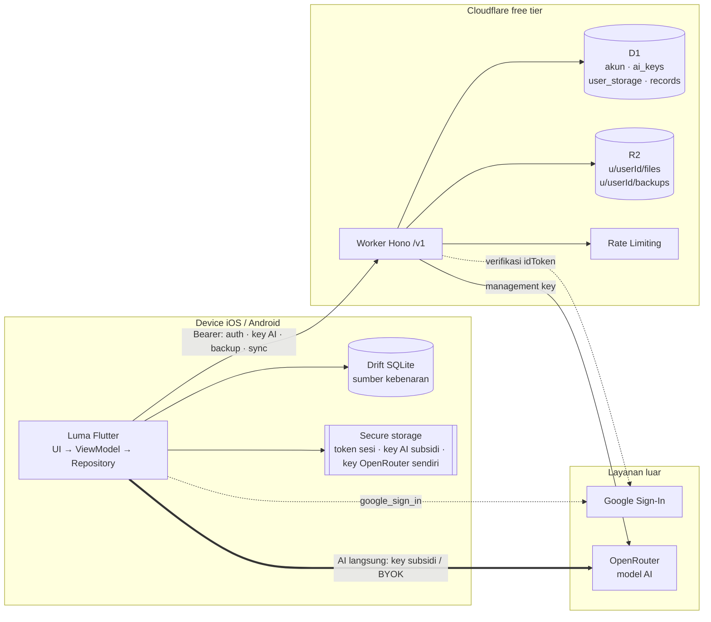
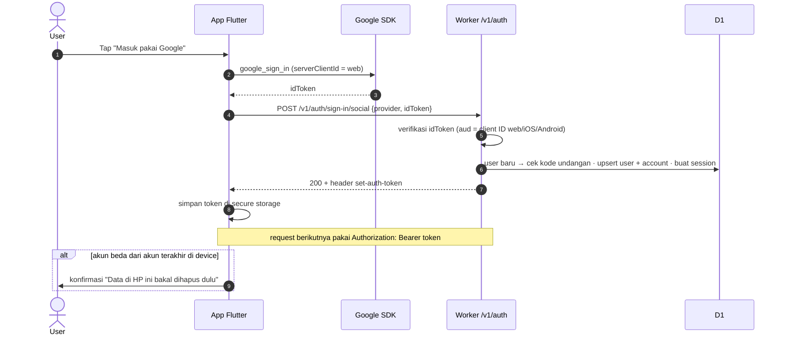
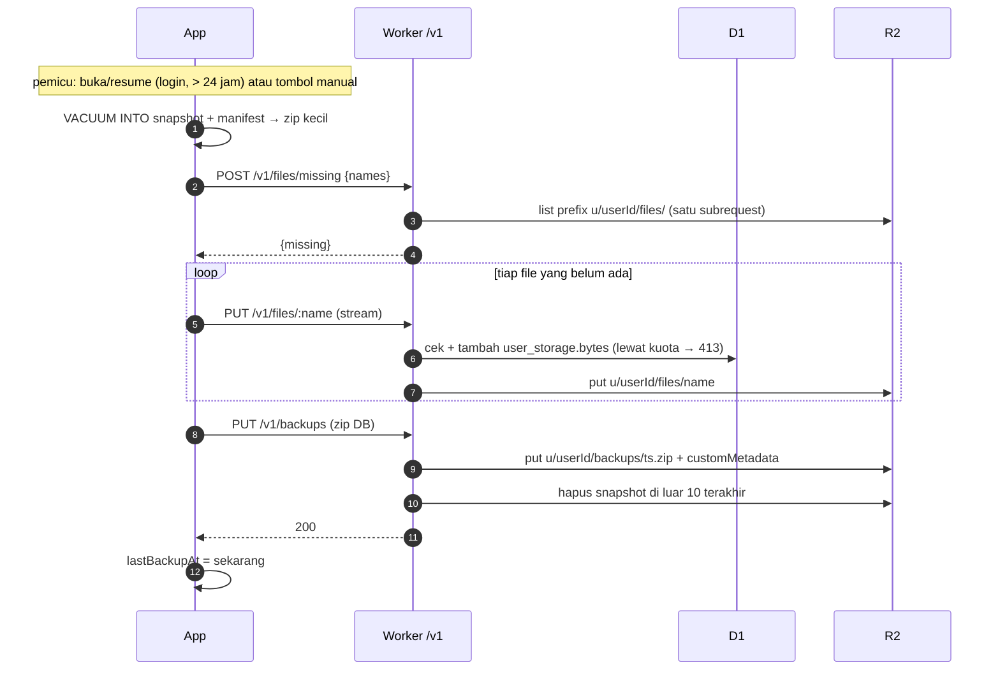
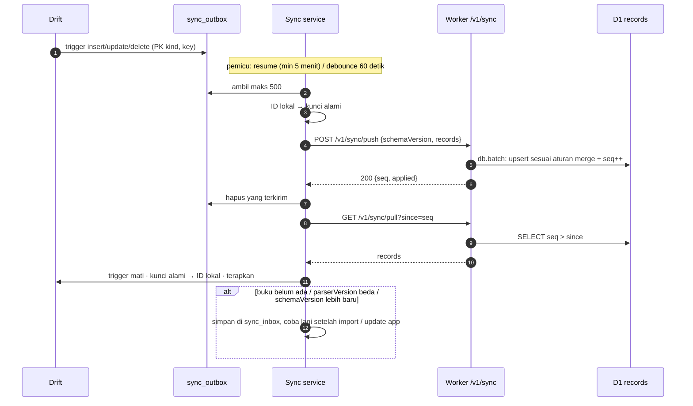
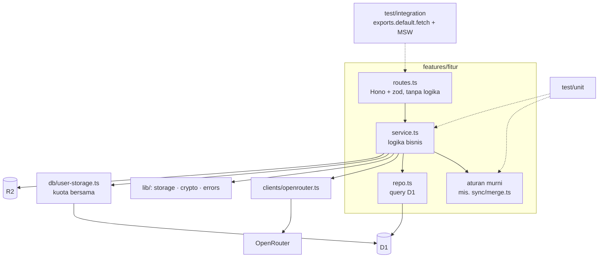
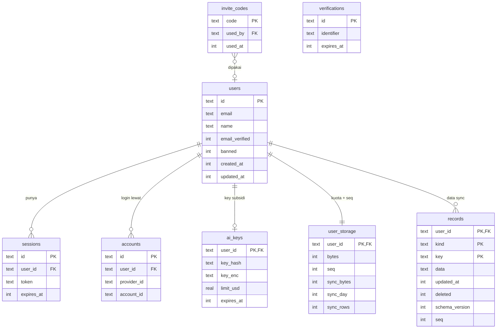
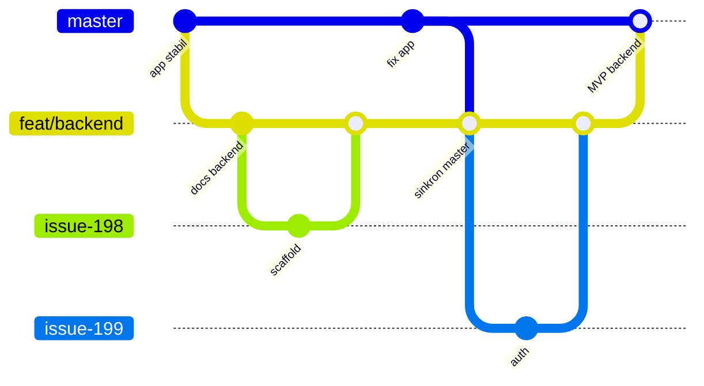

# Backend (Cloudflare)

> Kode di `apps/backend`. Hanya env dev yang di-deploy; env prod baru dibuat saat backend masuk `master` (lihat Setup & deploy). Keputusan awal dari diskusi 9 November 2026. Urutan issue dan checklist: induk [#197](https://github.com/choiruladamm/luma/issues/197).

App tetap **local-first**: Drift di device sumber kebenaran, semua fitur baca/AI/cari jalan tanpa backend. Backend cuma nambah akun, kuota AI subsidi, backup cloud, dan sync antar device.

## Gambaran sistem

Device tetap sumber kebenaran. Worker cuma melayani akun, key AI, backup, dan sync; AI dipanggil langsung dari device ke OpenRouter.



## Stack

| Layer | Pilihan | Catatan |
|---|---|---|
| API | Cloudflare Workers + Hono | Folder `apps/backend`, route di bawah `/v1` |
| Database | D1 (SQLite) + Drizzle | Migrasi lewat `drizzle-kit generate` → `wrangler d1 migrations apply` |
| File | R2 | Semua key per user: `u/{userId}/...` |
| Auth | Better Auth + plugin `bearer` | Butuh flag `nodejs_compat` |
| Tooling | Bun + Wrangler | Bun cuma tooling, runtime tetap Workers |
| Test | Vitest + `@cloudflare/vitest-plugin` (`cloudflareTest()`), MSW lewat `@msw/cloudflare` | `make backend-test`, lihat [Strategi test](#strategi-test) |

Tidak dipakai: Workers Static Assets untuk frontend (app-nya mobile; cuma halaman statis `/privacy` dan hapus akun), AI Gateway (AI tidak lewat backend, lihat [AI](#ai-subsidi--byok)).

## Aturan free tier (wajib)

**Semua kode backend dan client yang memanggil backend wajib muat di free tier Cloudflare.** Tiap fitur baru atau perubahan pemanggilan backend harus memperbarui [anggaran request](#anggaran-per-aksi) di bawah. Fitur yang gak muat anggaran: desain ulang dulu, bukan naik ke plan berbayar.

### Batas

| Layanan | Batas free | Kalau lewat |
|---|---|---|
| Workers | 100rb request/hari, **CPU 10ms/request**, 50 subrequest/request, body 100MB | Request gagal (error 1027 / CPU exceeded), bukan tagihan |
| D1 | 5GB, ±5jt baris dibaca + 100rb baris ditulis per hari (index ikut dihitung) | Query gagal sampai reset 00.00 UTC |
| R2 | 10GB-bulan, 1jt operasi Class A (tulis/list) + 10jt Class B (baca) per bulan | **Ditagih** (R2 butuh metode bayar), jadi paling ketat dijaga |

Menunggu `fetch`/I/O tidak dihitung CPU; `crypto.subtle`, `JSON.parse`, dan kompresi dihitung. Angka dicek ulang di dashboard sebelum implementasi.

### Aturan client

- **Tanpa polling.** Gak ada timer yang manggil backend berkala. Pemicu hanya: app dibuka/resume, aksi user, atau perubahan lokal.
- **Jarak minimum per pemicu otomatis**: sync paling cepat 5 menit sekali saat resume; push setelah perubahan lokal di-debounce 60 detik; backup otomatis 24 jam, dan setelah satu percobaan (sukses atau gagal) pemicu otomatis berikutnya menunggu minimal 1 jam (`retryGap`).
- **Dedupe sebelum kirim**: `sync_outbox` ber-PK `(kind, key)`, jadi 100 update posisi baca = 1 record.
- **Batch**: push maks 500 record per request; satu request `POST /v1/files/missing` untuk semua nama file.
- **Retry**: hanya untuk error jaringan/5xx, backoff eksponensial (`backendMaxAttempts = 3`: 1 percobaan + 2 retry, jeda 0,5 dtk lalu 1 dtk). 4xx tidak di-retry, kecuali backup cloud yang mengulang 429 `RATE_LIMITED` sampai 5 kali per file (`rateLimitRetries`) sesuai `Retry-After`. Hormati `Retry-After` pada 429/503. Pemicu otomatis yang gagal menunggu pemicu berikutnya, bukan loop.
- **Cache respons yang jarang berubah**: `/v1/ai/config` di-cache selama umur provider-nya, `/v1/ai/usage` cuma saat Pengaturan dibuka (cache 1 jam), key AI disimpan sampai 401 atau diperbarui 1 hari sebelum kedaluwarsa.
- **Sesi tidak dicek tiap app dibuka**: token dipakai langsung; 401 baru memicu login ulang.

### Aturan server

- **CPU**: upload/download di-stream (`c.req.raw.body` → R2), tidak di-buffer atau di-hash di Worker. Tidak ada scrypt JS. PBKDF2 (dev saja) pakai iterasi yang muat 10ms, diukur di `wrangler dev`. Payload push divalidasi ringan; batas ukuran body (sync 1MB) ditolak sebelum `JSON.parse`.
- **D1**: satu request = satu `db.batch()`; upsert yang datanya sama tidak menulis ulang (`ON CONFLICT ... WHERE excluded.updated_at > updated_at`). Index seminimal mungkin (tiap index = baris tulis tambahan).
- **Subrequest ≤ 50**: hapus R2 pakai `delete([...keys])` per 1000 key; kerja yang lebih besar (mis. hapus akun dengan banyak file) dicicil lewat beberapa request dari client atau Cron Trigger, bukan satu request raksasa.
- **R2 dibatasi per user**: kuota penyimpanan per user (awal 1GB, `vars` `USER_STORAGE_BYTES`) dipesan atomik sebelum upload (`reserveBytes`: satu upsert `bytes + size ≤ kuota`, jadi upload paralel gak bisa lolos cek bareng-bareng) di tabel `user_storage(user_id, bytes)`; lewat → 413. Upload gagal → pesanan dikembalikan. File maks 100MB. Retensi backup 10 snapshot.
- **Sync dibatasi per user** (kuota tulis D1 100rb baris/hari dan 5GB dipakai bareng semua user): `SYNC_DAILY_WRITES` (20.000 baris ditulis per hari UTC) → lewat = 429 `QUOTA_EXCEEDED` + `Retry-After` sampai 00.00 UTC; `SYNC_STORAGE_BYTES` (100MB, panjang key + JSON data semua record) → lewat = 413 `STORAGE_FULL`, kecuali batch yang mengecilkan data. Pemakaian di `user_storage.sync_bytes / sync_day / sync_rows`, dihitung pas dari selisih ukuran record lama vs baru. Push yang gak mengubah apa-apa gak dihitung.
- **Rate limit**: binding Workers Rate Limiting: per IP di semua `/v1/*` (`app.ts`), plus per user di `featureGuard` (files, backup, sync) dan `POST /v1/ai/key`. Lewat → 429 + `Retry-After`.
- **Endpoint Better Auth di-allowlist**: cuma `POST /v1/auth/{sign-up/email, sign-in/email, sign-in/social, sign-out}` (`AUTH_PATHS`); sisanya 404. Endpoint baru yang dipakai app ditambah ke situ.
- **Risiko yang diterima** (review #213, dicek ulang sebelum buka pendaftaran tanpa undangan):
  - Rate limiter Workers dihitung per lokasi Cloudflare, bukan global: batas efektif bisa lebih longgar dari 60/menit.
  - Batas 100rb request Workers/hari dan 5jt baris baca D1/hari bisa dihabisin lewat banjir request (endpoint tanpa login, atau pull sync berulang). `workers.dev` gak punya WAF; obatnya custom domain + rate rule Cloudflare (#204, #209). Sementara: saklar darurat + pantau Analytics.
  - `DELETE /v1/me` cukup token sesi, tanpa login ulang: token yang dicuri bisa hapus data cloud (data di HP tetap). Login ulang sebelum hapus akun butuh alur di app, dikerjain bareng #211 kalau perlu.
  - Token sesi disimpan apa adanya di D1 (bawaan Better Auth); D1 bocor = sesi bisa dipakai. Akses D1 cuma lewat akun Cloudflare.
  - `updatedAt` record sync dari jam device, jadi jam yang maju menang merge; cuma ngerusak data user itu sendiri.
- **Saklar darurat**: `vars` `SYNC_ENABLED`, `BACKUP_ENABLED`, `AI_KEY_ENABLED`. `false` → endpoint balas 503 + `Retry-After: 3600` tanpa menyentuh D1/R2; client berhenti sampai pemicu berikutnya setelah jeda itu.

### Anggaran per aksi

Perkiraan untuk satu user aktif per hari. Wajib diperbarui saat implementasi berubah.

| Aksi | Request Worker | Baris D1 | Operasi R2 |
|---|---|---|---|
| Login / daftar (#199) | 1–2, sekali per device | ±3–6 tulis; Google (#211): 7 query D1 + 1 subrequest JWKS Google per login | - |
| Auth per request (cek sesi bearer, #199) | termasuk di request lain | 1 baca (+1 tulis maks sekali sehari) | - |
| Key AI (`POST /v1/ai/key`, #200) | 1 per device per 30 hari (+1 setelah 401) | 2 baca (+1 tulis saat bikin/rotasi); subrequest OpenRouter 0 / 1 / 2 (+1 cek key saat `rotate`) | - |
| Usage/config AI (#200) | ≤ 2 (Pengaturan dibuka; cache usage 1 jam, config 24 jam) | usage 2 baca + 1 subrequest; config 1 baca | - |
| Backup otomatis (#201) | 2 + jumlah file baru (1×/hari) | 1 tulis (pesan kuota) per upload (+1 kalau upload gagal / retensi membuang snapshot) | `files/missing` 1 list/1000 file; file baru 1 head + 1 put; snapshot 1 put + 1 list (+1 delete) |
| Restore cloud (#201) | 2 + file yang belum ada di HP | - | 1 list + 1 baca snapshot + 1 baca per file |
| Sync push (#109: login, resume ≥ 5 menit, 60 detik setelah perubahan terakhir) | ±10–30; sync pertama maks 10 per pemicu | per push: 1 baca sesi + 1 `SELECT` record lama (baris = record di batch) + 1 baca kuota + 1 batch (`seq` + kuota + upsert yang berubah saja); ±50–300 tulis, ±100–500 baca | batch berisi buku: `files/missing` 1 list + 1 put per file yang belum ada (sama dengan backup, gak dobel) |
| Sync pull (#210: login, resume ≥ 5 menit, setelah push) | 1 per 500 record perubahan, maks 10 per pemicu (biasanya 1) | 1 baca sesi + baris yang dikembalikan saja (index `records_user_seq`), 0 tulis | - |
| Download buku di device baru (#210) | 1 per buku (sekali) + 1 dump per buku Markdown | - | 1 baca per buku |
| Login dashboard admin (docs/dashboard.md) | 3 per login (`sign-in/social`, callback, `get-session`), sesi 12 jam | `sign-in/social` 0 (state di cookie); callback ≤ 5 query (cari akun + user + cek admin + update token + simpan sesi) + 1 subrequest token Google; `get-session` 1 baca | - |
| Auth per request dashboard | termasuk di request lain | 1 baca (tanpa cookie / tanda tangan salah: 0), tanpa tulis (sesi gak diperpanjang) | - |

Patokan kapasitas: **±50 request/user/hari → ±2.000 user aktif/hari** di batas Workers; batas pertama yang kena realistisnya **D1 100rb baris tulis/hari** (±300–2.000 user tergantung aktivitas sync). Sync pertama (upload semua `ai_results` lama) dicicil maks 10 batch per pemicu supaya satu user tidak menghabiskan kuota tulis harian.

### Pemantauan

Workers Logs + dashboard Analytics (request, CPU p99, error) dicek tiap rilis backend. Tanda bahaya: CPU p99 > 5ms, error 1027, atau request/hari > 50rb (separuh batas) → cari pemicu yang bocor sebelum menambah fitur.

## Lingkungan

`wrangler` env `dev` dan `prod`, masing-masing D1, R2, dan workspace OpenRouter sendiri. Luma Dev (`id.ruma.luma.dev`) → env `dev`, Luma (`id.ruma.luma`) → `prod`, sama seperti aturan flavor di `apps/mobile/CLAUDE.md`. `baseUrl` di Flutter ditentukan per flavor.

Log: `observability.enabled: true` (Workers Logs). Pemulihan D1: Time Travel bawaan. Deploy manual `make backend-deploy`; CI/CD ditunda.

## Auth

Better Auth 1.7 dipasang di Hono (`/v1/auth/*`) dengan adapter `@better-auth/drizzle-adapter` (`provider: "sqlite"`, `usePlural: true`). Schema: `bunx auth@latest generate --config scripts/auth-schema.config.ts --output src/db/auth-schema.ts` (kolom langsung `snake_case`) → `bunx drizzle-kit generate` → `make backend-migrate e=dev`.

**CPU** (diukur `wrangler tail` di env dev, 12 November 2026):

| Endpoint | Median | Catatan |
|---|---|---|
| `GET /v1/me` (cek sesi) | 2 ms | Jalur panas. Gak lewat Better Auth: `findSessionUser` satu query join `sessions` + `users` |
| `POST /v1/auth/sign-in/email` | 19 ms | Better Auth + PBKDF2. Sekali per device, masuk toleransi "sesekali lewat" Cloudflare |
| `POST /v1/auth/sign-up/email` | ±50 ms | Sekali per akun |
| `POST /v1/auth/sign-in/social` (Google idToken) | 11 ms (9–18, 14 November 2026) | Verifikasi JWKS Google + 7 query D1. Sekali per device, masuk toleransi "sesekali lewat" |

- Instance Better Auth mahal dibuat, jadi dipakai ulang per isolate (`getAuth`, kunci objek `env`).
- **Aturan**: route Luma (`/v1/me`, sync, backup, key AI) cek sesi lewat `requireSession` (D1 langsung), **jangan** `auth.api.getSession`. Better Auth cuma untuk `/v1/auth/*`.
- Cloudflare memberi tiap isolate toleransi untuk request yang *sesekali* lewat 10 ms; yang *konsisten* lewat dihentikan (error 1102). Login boleh sesekali lewat, jalur panas tidak.

- **Dev**: email + password, hanya kalau `ENV != prod`. Hash password diganti PBKDF2-SHA256 lewat `crypto.subtle` (`emailAndPassword.password.hash/verify`), 20.000 iterasi (±1,5 ms di laptop), iterasi ikut disimpan di hash. Di bawah anjuran OWASP (600.000) karena batas CPU; diterima karena login email cuma ada di dev. Argon2id / scrypt / bcrypt (memory-hard, lebih tahan GPU) sudah dipertimbangkan: lewat JS/WASM puluhan–ratusan ms per hash, gak muat CPU 10 ms. **Aturan**: prod gak pernah menyimpan password; login selain Google = Sign in with Apple atau OTP email, bukan password.
- **Prod**: Google lewat **idToken native** (`google_sign_in`, `serverClientId` = web client ID). Server: `socialProviders.google.clientId` berupa array web/iOS/Android. Tanpa redirect OAuth di mobile.
- **Sign in with Apple**: wajib (App Store 4.8) kalau masuk App Store sambil nawarin Google; polanya sama (idToken). Ditunda sampai rilis App Store.
- **Gerbang beta**: kode undangan lewat header `x-invite-code` saat daftar, dipakai atomik di `databaseHooks.user.create.before` (satu `UPDATE … WHERE used_at IS NULL`), 403 dengan kode berbeda: tanpa header `INVITE_CODE_REQUIRED` (app buka layar kode undangan), kode gak ada `INVALID_INVITE_CODE`, udah dipakai `INVITE_CODE_USED`. Format `LUMA-XXXXX-XXXXX` (10 karakter acak dari 32 huruf/angka tanpa 0/O/1/I, ±10^15 kemungkinan, gak bisa ditebak lewat brute force walau IP dirotasi); huruf besar/kecil dan strip gak ngaruh (`normalizeInviteCode`), disimpan dalam bentuk normalisasi. Kode lama `LUMA-XXXX` (±10^6) masih diterima, tapi jangan bikin lagi; yang belum dipakai dihapus. Dimatikan lewat `vars` `INVITE_REQUIRED=false` saat pricing siap. Kode dibuat lewat `make backend-invite e=dev n=3` (`newInviteCode` + insert ke D1 remote, kode dicetak).
- **Google**: aktif kalau `vars` `GOOGLE_CLIENT_IDS` (web,ios,android, dipisah koma) diisi; secret `GOOGLE_CLIENT_SECRET`. Project Google Cloud `luma-reader-9900`, consent screen External mode Testing (cuma test user yang bisa login; idToken dipakai sekali buat bikin sesi, jadi batas 7 hari refresh token gak berlaku). Publish buat umum: [#215](https://github.com/choiruladamm/luma/issues/215). Client per app: web (= `serverClientId`, `aud` idToken), iOS per bundle ID, Android per package + SHA-1 (release keystore `key.properties` dan debug keystore buat build debug/emulator). Web client dipakai bersama dev dan prod; iOS dan Android punya client per bundle/package (`id.ruma.luma.dev`, `id.ruma.luma`). Android prod cuma didaftarin SHA-1 release keystore, jadi login Google di build debug prod (`make run`) gagal. Test: `test/integration/auth-google.test.ts` (JWKS + idToken RS256 palsu lewat MSW, fixture `auth-sign-in-social.json`).
- **App (`google_auth.dart`)**: `NativeGoogle` (`google_sign_in` 7) per flavor dari `googleClients`; flavor tanpa entri → `UnconfiguredGoogle`. iOS butuh client ID-nya sendiri + URL scheme `REVERSED_CLIENT_ID` lewat build setting `GOOGLE_REVERSED_CLIENT_ID` per konfigurasi Xcode. Luma Dev tetap layar email + sandi; `--dart-define=GOOGLE_LOGIN=true` maksa layar Google buat uji.
- **Flutter**: tanpa SDK resmi; panggil REST langsung lewat `dio` (`/sign-in/email`, `/sign-up/email`, `/sign-in/social` dengan `{provider: "google", idToken: {token}}`). Token dari header `set-auth-token` (bentuk `<token>.<signature>`) disimpan di `flutter_secure_storage`, dikirim sebagai `Authorization: Bearer`. Error Better Auth `{code, message}` dibungkus server jadi format seragam `{error: {code, message}}`.

Alur login Google (prod):



### Sesi & akun

**Login wajib** (keputusan 12 November 2026): app tanpa sesi tersimpan membuka layar Masuk dulu (redirect go_router), termasuk install yang sudah punya data. Supaya tetap local-first:

- **Sekali saja**: token sesi di secure storage. Ada token → app langsung terbuka tanpa menunggu backend, offline pun jalan. Gerbang cuma cek "ada token", bukan memanggil server.
- **Data lama**: data Drift yang sudah ada tidak disentuh; login pertama menjadikannya milik akun itu (ikut sync nanti).
- **Sesi kedaluwarsa / 401**: tidak mengunci app. `/v1/me` dicek di latar saat app dibuka (`AuthController`); 401 → status `expired`, token TETAP disimpan, banner "Sesi lo habis" di Rak (board Akun 12, × nutup sampai app dibuka lagi). Sync, backup cloud, dan pengambilan key AI berhenti diam-diam. Baca, cache, dan BYOK tetap jalan. "Login lagi" buka layar Masuk; router cuma mengunci ke `/login` saat `signedOut`.
- **Logout**: data lokal tetap, kembali ke layar Masuk.
- **Risiko App Store 5.1.1**: Apple bisa menolak login wajib untuk app yang fitur intinya tidak berbasis akun. Diterima selama distribusi sideload; ditinjau ulang sebelum submit App Store.
- **Ganti akun**: login dengan akun yang beda dari akun terakhir di device (`SessionStore` simpan id + email akun terakhir) → sesi baru BELUM disimpan, dialog board Akun 10. "Hapus isi HP & lanjut" = `LocalDataRepository.wipeBooks()` (semua buku lewat `BookRepository.delete` + `ai_calls`; pengaturan tetap) lalu `commit`. "Pakai akun lama aja" = `discard` (sesi baru di-sign-out di server), HP tetap milik akun lama.
- **UI** (board halaman "11 · Akun & login" di Stabilo): layar Masuk `/login` di luar shell (Google di rilis, email + Daftar/Masuk di Luma Dev via `appFlavor`), kode undangan, Pengaturan → Akun (`/settings/account`: foto, nama, email, kartu kuota AI, Keluar, Hapus akun dengan 3 centang), toast akun (tab kuning/abu/pink). Tombol Google pakai `google_sign_in` (aset tombol resmi); build tanpa flavor memakai `UnconfiguredGoogle` yang melempar `GOOGLE_NOT_CONFIGURED`.
- **Hapus akun** (wajib App Store 5.1.1(v) dan Play Store): `DELETE /v1/me` menghapus baris D1 user, semua objek R2 `u/{userId}/`, dan key OpenRouter-nya. Kalau objek R2 banyak, dihapus per halaman dan server balas 202 `pending` (user belum dihapus); client memanggil lagi sampai 200. Play Store butuh URL web untuk hapus akun → halaman kecil di Worker.
- **Kebijakan privasi**: halaman statis `/privacy`: data yang disimpan (akun, backup, data sync), teks yang dikirim ke OpenRouter, cara hapus akun.

## AI (subsidi + BYOK)

AI tetap dipanggil **langsung dari device ke OpenRouter**; `OpenRouterService`, streaming, `ai_calls`, dan retry tidak berubah. Yang berubah cuma asal key:

```
key = openrouter_api_key ?? ai_subsidy_key
```

- **Subsidi (default)**: backend membuat key OpenRouter per user lewat management key (`POST /api/v1/keys`), dibuat **lazy** saat AI pertama kali dipakai, bukan saat daftar.
- **BYOK**: user isi key OpenRouter sendiri (field paste yang sudah ada). Kalau diisi, menang; dikosongkan → balik ke subsidi. Key BYOK yang sudah tersimpan sebelum login tetap dipakai setelah login.
- API key (subsidi maupun BYOK) tetap hanya di secure storage, tidak ikut backup/sync.

Alur key AI:


### Endpoint

| Endpoint | Fungsi |
|---|---|
| `POST /v1/ai/key` | Belum punya → buat key; sudah → kirim key yang sama (satu key per user, dua device tidak dapat kuota ganda). Ditolak kalau `banned` |
| `GET /v1/ai/usage` | Usage + limit dari OpenRouter (`GET /keys/{hash}`) untuk "Sisa kuota". User `banned` → 403 `AI_BANNED` (meter "Dicabut") |
| `GET /v1/ai/config` | Daftar model yang diizinkan untuk mode subsidi |

D1: `ai_keys(user_id PK, key_hash, key_enc, limit_usd, expires_at, created_at)` + kolom `users.banned` (Better Auth `additionalFields`, `input: false`, `returned: false`). Key disimpan terenkripsi AES-GCM (`v1.<iv>.<ct>`, kunci secret `AI_KEY_ENC_SECRET`) karena OpenRouter cuma memberi teks key sekali saat dibuat. Kunci enkripsi hilang/diganti → key lama gak kebaca → otomatis dirotasi, bukan error.

Aturan `issueKey`: pakai ulang selama masih berlaku (subrequest 0), bikin lazy, rotasi sehari sebelum kedaluwarsa / saat gak kebaca / saat `{"rotate": true}` **dan key-nya udah gak ada di OpenRouter** (`GET /keys/{hash}` 404) (hapus lama + bikin baru). `rotate` buat key yang masih ada diabaikan (key yang sama dikirim balik): limit harian nempel di key, jadi rotasi bebas = kuota $0.02 baru tiap kali minta, dan satu user bisa ngabisin budget workspace semua orang, limit `vars` berubah → `PATCH` limit key yang ada. Hapus akun mencabut key duluan.

### Batas & pengaman

| Risiko | Pengaman |
|---|---|
| Biaya per user | `limit: 0.02`, `limit_reset: "daily"` → maks ±$0.60/bulan per user, ±30–50 tap/hari |
| Total biaya | Budget guardrail workspace OpenRouter **$5/bulan**. Habis → semua key subsidi 402 → "Kuota gratis lagi abis, pakai key sendiri dulu yuk". Saldo OpenRouter tanpa auto top-up sebagai lapis kedua |
| Key diekstrak dari device | Limit harian kecil + `expires_at` 30 hari. 401 → app panggil `POST /v1/ai/key {"rotate": true}` → kalau key memang udah gak ada di OpenRouter, key lama dihapus dan key baru dibuat; kalau masih ada, key yang sama dikirim balik (rotasi gak bisa dipakai buat reset limit harian). Ban lewat `make backend-ban e=prod email=…` (env `OPENROUTER_MANAGEMENT_KEY`): `DELETE /keys/{hash}` duluan (key yang udah diekstrak langsung mati, bukan nunggu 30 hari), lalu `banned = 1` + hapus baris `ai_keys` |
| Model mahal | Workspace `luma-subsidi-dev` / `luma-subsidi-prod` (satu per env, `OPENROUTER_WORKSPACE_ID`) dengan default guardrail `allowed_models` (model default + kandidat murah + **model embedding** Ngobrolin). Mode subsidi: pemilih model hanya menampilkan daftar dari `/v1/ai/config` |
| Spam akun | Login prod hanya Google, key lazy, `user_id` unique, rate limit `POST /v1/ai/key` per IP + per user (binding Workers Rate Limiting), kode undangan selama beta |

Batas terburuk: **biaya subsidi per bulan ≤ min(budget workspace, jumlah user × limit bulanan per user)**, ditegakkan OpenRouter.

Angka di `vars` `wrangler.jsonc` (`AI_DAILY_LIMIT_USD`, `AI_MONTHLY_BUDGET_USD`). Ubah limit → key yang sudah ada di-`PATCH`. Paket berbayar nanti = limit per key lebih besar.

**Spike OpenRouter (12 November 2026, terbukti)**: `POST /keys` menerima `workspace_id`, `limit`, `limit_reset: "daily"`, `expires_at`; respons `{data: {hash, …}, key}`. Workspace `luma-subsidi-dev` (`8cad9ec8-0469-4bb5-912c-8c5411269ae8`) dibuat lewat `POST /workspaces`; **guardrail default workspace** diatur lewat `PATCH /guardrails/{default_guardrail_id}` (nama guardrail default gak bisa diubah) dengan `allowed_models` (3 model chat + 2 embedding) dan `limit_usd: 5`, `reset_interval: "monthly"`. Guardrail default berlaku ke semua key di workspace, jadi gak perlu assign per key. Model di luar allowlist dijawab **404** ("0 endpoints … matching your guardrail restrictions"), bukan 403: client membedakannya dari model yang memang gak ada. OpenRouter menyimpan nama model versi bertanggal (`deepseek/deepseek-v4.1-flash-20260910`); alias tanpa tanggal tetap jalan.

Rahasia: management key OpenRouter (`OPENROUTER_MANAGEMENT_KEY`, gak bisa dipakai inference) + `AI_KEY_ENC_SECRET` per env. `vars`: `AI_DAILY_LIMIT_USD`, `AI_MONTHLY_BUDGET_USD` (cuma catatan; yang menegakkan guardrail), `AI_KEY_TTL_DAYS`, `OPENROUTER_WORKSPACE_ID`, `AI_CHAT_MODELS`, `AI_EMBEDDING_MODELS` (harus sama dengan guardrail).

**CPU** (env dev, 25× per endpoint): `GET /v1/ai/config` median 2 ms, `GET /v1/ai/usage` 4 ms, `POST /v1/ai/key` 5 ms. Lonjakan > 10 ms juga muncul di `/v1/health` (isolate baru), jadi dianggap biaya cold start; endpoint ini jarang dipanggil.

## Backup cloud

Memakai alur [backup.md](backup.md) yang sudah ada; yang diganti cuma tujuan (share sheet → R2). Backup lewat share sheet tetap ada.

Zip penuh tidak di-upload (bisa ratusan MB, lewat batas body 100MB). Isinya dipisah:

| Isi | Key R2 | Kapan |
|---|---|---|
| File buku & cover | `u/{userId}/files/{fileName}` (nama file sudah berbasis hash) | Sekali, hanya yang belum ada |
| Snapshot DB | `u/{userId}/backups/{ts}.zip` (`manifest.json` + `luma.sqlite`) | Tiap backup |

| Endpoint | Fungsi |
|---|---|
| `POST /v1/files/missing` | `{names}` → `{missing}`, lewat satu `R2.list` prefix (bukan HEAD per file, batas 50 subrequest) |
| `PUT /v1/files/:name` | Body di-stream ke R2, maks 100MB |
| `PUT /v1/backups` | Zip kecil, `customMetadata` dari manifest; hapus snapshot lama di luar 10 terakhir |
| `GET /v1/backups` | List lewat `R2.list({prefix, include: ["customMetadata"]})`, tanpa tabel D1 |
| `GET /v1/backups/:id` | Download (`id` = `yyyyMMddTHHmmssZ`; gak ada → 404 `BACKUP_NOT_FOUND`) |
| `GET /v1/files/:name` | Download file buku/cover (restore di device baru) |

Detail implementasi (#201):

- Semua route: `killSwitch("BACKUP_ENABLED")` → `requireSession` → rate limit per user. Nama file `^[A-Za-z0-9._-]{1,200}$`; `Content-Length` wajib (400 kalau gak ada), maks 100MB (413 `PAYLOAD_TOO_LARGE`). Body di-stream ke R2 lewat `FixedLengthStream`, gak di-buffer/hash di Worker; panjang yang bohong = upload gagal.
- Kuota: `user_storage.bytes + size ≤ USER_STORAGE_BYTES` (vars, 1GB) → lewat = 413 `STORAGE_FULL`. Dipesan atomik sebelum `put` (`reserveBytes`), dikembalikan kalau `put` gagal. File yang udah ada (`head`) gak diunggah ulang dan gak dihitung dobel. Snapshot ikut dihitung; yang dibuang retensi mengurangi `bytes`.
- `PUT /v1/backups`: manifest app dikirim di header `x-backup-manifest` (JSON `manifest.json`), disimpan sebagai `customMetadata` (`createdAt` dinormalisasi ke UTC). `GET /v1/backups` → `{"backups": [...]}` terbaru dulu.
- Ukuran nyata snapshot (13 November 2026): 14,6MB zip dari DB 42MB, jadi multipart gak dipakai. CPU di env dev (`wrangler tail`, hangat): `GET /v1/backups` 3ms, `PUT /v1/backups` 15MB 5–14ms, `PUT /v1/files/:name` 15MB 8ms; cold start sampai ±26ms.

Alur backup:



- **Pemicu**: otomatis saat app dibuka/resume kalau login, backup cloud terakhir > 24 jam, dan rak gak kosong (diam-diam, gagal = coba lagi resume berikutnya; device baru yang belum punya buku gak ngirim snapshot kosong yang bakal jadi terbaru di daftar restore) + tombol "Backup ke cloud" di Pengaturan (sheet progres + toast yang sama). Sukses mengisi `lastBackupAt`, jadi banner pengingat ikut tenang.
- **Retensi**: 10 snapshot terakhir, dihapus di request `PUT` yang sama (bukan lifecycle rule umur, supaya jeda lama tidak menghapus semuanya).
- **Restore**: download zip DB → download file yang belum ada lokal → folder ekstrak sementara → validasi & swap `RestoreService` yang sudah ada (refactor kecil: terima folder hasil ekstrak).

## Sync antar device ([#109](https://github.com/choiruladamm/luma/issues/109))

Per baris, last-write-wins dengan aturan merge per tabel, memakai **kunci alami** (tanpa kolom `uid`). Kunci diturunkan dari isi, jadi dua device yang sudah punya buku yang sama otomatis menyatu, bukan dobel.

### Kunci global

| Data | Kunci |
|---|---|
| Buku | `hash` (EPUB/PDF) atau `md:{bookKey}` (Markdown) |
| Bab | `{bookKey}/{sortOrder}`, hanya berlaku kalau `parserVersion` sama |
| `ai_results`, `ai_breakdowns` | `{babKey}/{groupIndex}` |
| `reading_progress` | `{bookKey}` |
| `reading_sessions` | `{bookKey}/{startedAt ms}` |
| `settings` | `key`, hanya allowlist |
| `chat_sessions` | `{bookKey}/{createdAt ms}` |
| `chat_turns` | `{sessionKey}/{sequence}`, hanya turn yang sudah selesai |

### Aturan merge

| Tabel | Aturan |
|---|---|
| `books` (metadata, judul edit, cover default) | Terbaru menang; `firstOpenedAt`/`finishedAt` ambil paling awal; `readingSeconds` ambil terbesar |
| `reading_progress` | Terbaru menang |
| `reading_sessions` | Append-only, tidak konflik |
| `ai_results`, `ai_breakdowns` | `promptVersion` lebih tinggi menang, lalu `createdAt` terbaru |
| `settings` | Terbaru menang per key; `backup.*`, `catalog.*`, `lastBackupAt` tidak ikut (per device). `ai.model` ikut |
| `chat_sessions`, `chat_turns` | Terbaru menang; turn `running` tidak di-push |
| Hapus buku | Tombstone; device lain ikut hapus, cascade lokal membereskan sisanya |

Tidak ikut: `chapters`/`paragraphs` (diparse ulang dari file), `catalog_books`, `chat_indexes`, `chat_vectors` (turunan). Ditunda: `ai_calls`, `chat_chapter_notes`.

### Mekanisme

Server (D1):

```sql
records(user_id, kind, key, data JSON, updated_at, deleted, schema_version, seq,
        PRIMARY KEY (user_id, kind, key))
```

- `POST /v1/sync/push {schemaVersion, records}` → merge, isi `seq` baru. Batch maks 500.
- `GET /v1/sync/pull?since={seq}` → baris dengan `seq` lebih besar. Cursor dari server, bukan jam device.

Client (butuh migrasi Drift: tabel baru + trigger, tanpa ubah kolom tabel lama):

- `sync_outbox(kind, key, updatedAt)` diisi **trigger SQLite** di tiap tabel yang di-sync; repository tidak disentuh.
- Push: outbox → ubah ID lokal ke kunci alami → kirim.
- Pull: kunci alami → ID lokal → terapkan, trigger dimatikan selama pull supaya tidak di-push balik.
- `sync_inbox`: record yang belum bisa diterapkan (buku belum ter-download, `parserVersion` beda, atau `schemaVersion` record lebih baru dari app) → dicoba lagi setelah import / update app.

Detail implementasi push (#109):

- **Spec per kind** di `lib/data/database/sync_schema.dart` (`syncKinds`): ekspresi kunci alami SQL, syarat ikut, `json_object` data. Dari situ dibikin trigger outbox, backfill migrasi 18, dan query data saat push. Kunci dihitung trigger saat kejadian (setelah delete ID lokal hilang). Spec yang berubah = naikin schema + pasang ulang trigger.
- **Kind**: `book`, `reading_progress`, `reading_session`, `ai_result`, `ai_breakdown`, `setting`, `chat_session`, `chat_turn`. Data pakai nama field Dart, waktu ISO 8601 UTC, ID lokal diganti `chapterSortOrder` + `parserVersion`. Tombstone cuma `book` dan `chat_session` (hapus user); hapus cascade anak gak dikirim. Setting allowlist `syncedSettings` (model AI, bahasa, urutan/tampilan rak, tema, dan pengaturan pembaca `reader.*`).
- **Waktu**: `updatedAt` record = jam device saat trigger jalan (bukan jam server: edit offline yang telat dikirim gak boleh ngalahin edit yang lebih baru).
- **Push** (`SyncRepository`): satu putaran ambil outbox `updated_at ≤ mulai` lewat cursor, maks 500 record / ±900KB per request, maks 10 batch. Outbox dihapus kalau `updatedAt` belum berubah selama push. Baris anak yang udah hilang dibuang tanpa dikirim. 429/503 → jeda sesuai `Retry-After`.
- **Server** (`features/sync/`): batas D1 free 50 query + 100 parameter per request, jadi 1 `SELECT` lewat `json_each`, merge di JS (`merge.ts`), lalu satu `db.batch()`: `seq += n` + satu `INSERT … SELECT FROM json_each … ON CONFLICT`. Record dari app dengan `schemaVersion` lebih lama gak menimpa record versi lebih baru. Sebelum batch tulis, kuota sync dicek (lihat Aturan server); batch yang sama juga memperbarui `sync_bytes` / `sync_rows`. Balas `{seq, applied}`. Batas yang disengaja: merge dibaca di luar transaksi; dua device push kunci sama di milidetik yang sama → yang terakhir nulis menang.
- **File buku**: batch yang berisi record buku → `files/missing` buat file, cover, dan dump Markdown `md-{bookKey}-{contentRevision}.json.gz` (bab + paragraf `[index, groupIndex, type, text]`), upload yang belum ada. Gagal upload → record buku tetap di outbox (dikirim ulang, server gak nulis data yang sama).
- **Pemicu** (`SyncTrigger`): login, resume (min 5 menit), dan 60 detik setelah perubahan terakhir di tabel yang di-sync (`tableUpdates` Drift; tulisan trigger ke outbox gak keliatan stream).

Detail implementasi pull (#210):

- **Server**: `GET /v1/sync/pull?since={seq}&limit=500` → `{records, nextSeq, more}`, satu query lewat index `records_user_seq` (migrasi 0004). Record dibentuk jadi JSON di SQL (`json_object`), Worker cuma nyambung string, tanpa `JSON.parse` 500 record.
- **Client** (`SyncApplier`): kunci alami → ID lokal per kind (buku lewat `hash`/`book_key`, bab lewat `sortOrder` kalau `parserVersion` sama, sesi chat lewat `(book_id, created_at)`). Urutan dalam satu halaman: setting → buku → sesi chat → anak. Satu transaksi per halaman, cursor `sync.pullSeq` (`{userId}:{seq}`, ganti akun = mulai 0) disimpan di transaksi yang sama.
- **Merge client**: outbox lokal punya perubahan lebih baru untuk kunci yang sama → lokal dipertahankan (nanti di-push). Buku: field metadata dari pemenang, `firstOpenedAt`/`finishedAt` paling awal, `lastOpenedAt`/`readingSeconds` terbesar; kalau data lokal ikut nyumbang, kuncinya tetap di outbox supaya hasil merge naik ke server. AI: `promptVersion` lalu `createdAt`. Turn chat yang lagi jalan di device ini gak ditimpa.
- **Gak di-push balik**: trigger outbox tetap nyala; di akhir transaksi baris outbox yang ditulis sejak transaksi mulai dihapus (kecuali kunci hasil merge di atas). Impor buku hasil download juga bukan perubahan lokal: entri outbox bukunya dihapus setelah impor.
- **`sync_inbox`**: buku belum ada di device, `parserVersion` beda, `schemaVersion` record lebih baru dari app, atau sesi chat belum ada → ditahan, dicoba lagi abis tiap pull dan abis tiap buku keimpor (sync jalan tiap app dibuka, jadi abis update app juga). Tombstone buku ikut buang record anak buku itu dari inbox.
- **Download buku**: record buku di inbox = antrean. EPUB `importEpub` / PDF `importPdf` dari `GET /v1/files/:name` (hash sama, jadi gak dobel), Markdown dari dump (bab + paragraf + `groupIndex` apa adanya). Satu per satu, jaringan apa aja, gagal = tetap di inbox. Bab Markdown yang ditambah belakangan di device lain belum ikut (#212).

Alur push/pull:



### File buku

- Folder `u/{userId}/files/` yang sama dengan backup cloud.
- Device baru: semua buku di-download + import otomatis di background, lewat jaringan apa aja (tanpa batas Wi-Fi: buku 0,5–15MB). Indikator "Nyinkronin 3/12 buku" (`SyncBanner`) di slot banner Rak (juga di rak kosong) selama download, tanpa board: anatomi kartu "Nyiapin katalog buku" di Cari buku. Ilang sendiri begitu kelar.
- **Buku Markdown** (tanpa file sumber): chapters + paragraphs (dengan `groupIndex`) di-dump ke `md-{bookKey}-{contentRevision}.json.gz`, diperlakukan sebagai file. Bab ditambah di dua device sekaligus → terakhir menang.

### Versi app

Route di bawah `/v1`. Push membawa `schemaVersion`; pull menahan record dengan versi lebih baru di `sync_inbox` sampai app di-update (build sideload lama tetap jalan).

### Ditolak

PowerSync / ElectricSQL / Turso (di luar Cloudflare, mengganti fondasi Drift), CRDT (berlebihan untuk satu user beberapa device), sync = restore snapshot terbaru (perubahan device lain hilang).

## Arsitektur kode

```
apps/backend/
├── wrangler.jsonc            # env dev/prod, D1, R2, rate limit, vars
├── drizzle.config.ts
├── migrations/               # hasil drizzle-kit; di-apply wrangler dan test
├── scripts/e2e.sh            # make backend-e2e: Worker lokal + test Dart sync
├── src/
│   ├── index.ts / app.ts     # Hono app: middleware + mount route, export default
│   ├── env.ts                # AppEnv: Bindings + `c.var` (db, openrouter, user)
│   ├── middleware/           # requestId, deps, killSwitch, bodyLimit, session, rateLimit, guard
│   ├── auth/                 # Better Auth (config, PBKDF2, undangan, cek sesi bearer)
│   ├── db/
│   │   ├── schema.ts         # tabel Drizzle + schema Better Auth hasil generate
│   │   └── user-storage.ts   # tabel bersama `user_storage` (kuota R2 file + backup)
│   ├── lib/                  # errors, crypto (AES-GCM), encoding, storage (aturan R2 per user)
│   ├── clients/openrouter.ts # fetch tipis ke OpenRouter (di-mock di test)
│   └── features/<fitur>/     # account, ai-key, auth, backup, files, health, legal, sync
│       ├── routes.ts         # Hono + validator, ambil deps dari `c.var`, tanpa logika
│       ├── service.ts        # logika bisnis, dependency lewat parameter
│       ├── repo.ts           # semua query D1 fitur itu
│       └── *.ts (pure)       # aturan murni (mis. sync/merge.ts), tanpa I/O
└── test/
    ├── unit/                 # aturan murni + service
    ├── integration/          # exports.default.fetch per fitur + helper login
    ├── fixtures/contract/    # JSON request/response, dibaca juga oleh test Dart
    ├── helpers/              # login, anggaran query/subrequest, kontrak, limit rate test
    └── setup.ts              # applyD1Migrations, MSW (@msw/cloudflare)
```

Lapisan per fitur dan titik test:



Pipeline request (route `/v1/auth/*` milik Better Auth tidak lewat `session`):


- **Urutan middleware**: `requestId → (rateLimit IP + deps di semua /v1) → killSwitch → bodyLimit → session → rateLimit user → validator → handler`, `onError` di luar. Saklar darurat jalan sebelum D1/R2 disentuh. Fitur berkuota (files, backup, sync) pakai `featureGuard(flag)` = saklar → sesi → rate limit per user.
- **Lapisan**: semua query D1 ada di `features/<fitur>/repo.ts` (plus `db/user-storage.ts` buat tabel yang dipakai beberapa fitur), service gak pernah nulis SQL. Fungsi repo = satu unit anggaran query (komentarnya bilang berapa query), jadi aturan free tier tetap kebaca di satu tempat. Fitur gak ngimpor isi fitur lain, kecuali hapus akun yang memang manggil `revokeKey` (ai-key). Operasi R2 tetap di service: tiap fitur punya prefix sendiri di bucket yang sama, aturan bersamanya di `lib/storage.ts`.
- **Drizzle vs SQL mentah**: Drizzle di semua repo, kecuali `sync/repo.ts`: batch 500 record harus lewat `json_each` dalam satu statement (batas D1 free 50 query + 100 parameter per request), dan pull membentuk JSON di SQL biar Worker gak `JSON.parse` 500 record.
- **Deps per request**: middleware `deps` naruh `db` (Drizzle) dan `openrouter` di `c.var`; handler gak ngerakit client sendiri.
- **Validasi**: `@hono/zod-validator` + zod di semua input. Error seragam `{"error": {"code", "message"}}`; Flutter memetakan `code` ke enum.
- **Tanpa OpenAPI / codegen client Dart**: ±20 endpoint, fixture kontrak cukup. Ditinjau ulang kalau frontend web (#208) jalan.
- **Ukuran script**: Workers free maks 3MB terkompres; dicek lewat `wrangler deploy --dry-run` sejak #198.
- **`seq` sync per user** di `user_storage.seq`, dinaikkan di `db.batch()` yang sama dengan upsert record (D1 batch atomik).
- **Alat cek cepat**: Hono CLI (`npx hono request` / `batch`) boleh dipakai untuk eksplorasi; bukti tetap test vitest.

### Konvensi penamaan

| Lapisan | Format | Contoh |
|---|---|---|
| Tabel & kolom D1 | `snake_case`, tabel jamak | `users`, `ai_keys`, `user_id`, `expires_at` |
| Property TypeScript (Drizzle) | `camelCase` | `userId`, `expiresAt` |
| JSON request/response | `camelCase` | `{"keyHash": "…", "expiresAt": "…"}` |
| Kode error | `UPPER_SNAKE_CASE` | `QUOTA_EXCEEDED`, `INVALID_INVITE_CODE` |
| Path URL | huruf kecil, `kebab-case` | `/v1/ai/key`, `/v1/sync/push` |
| Waktu di JSON | ISO 8601 UTC | `"2026-11-12T15:04:05.123Z"` |
| Waktu / boolean di D1 | integer (`timestamp_ms` / `boolean` mode Drizzle) | `expires_at = 1794500000000` |

- Mapping `camelCase` ↔ `snake_case` lewat opsi `casing: "snake_case"` di `drizzle()` dan `drizzle.config.ts`; kode tidak menulis nama kolom satu-satu.
- **Jebakan Better Auth**: schema hasil generate bisa menulis nama kolom eksplisit (`text("emailVerified")`) yang menang atas `casing`. Habis generate, nama kolom diubah ke `snake_case`, property dibiarkan (Better Auth memetakan lewat property). Test integrasi auth membuktikan.
- JSON `camelCase` karena respons Better Auth sudah `camelCase` dan Dart (`freezed` + `json_serializable`) default `camelCase`, jadi tanpa `@JsonKey(name:)`.
- Kode error ikut format Better Auth (`INVALID_EMAIL_OR_PASSWORD`), satu pola di client.
- `records.data` (sync) memakai nama field Dart (`camelCase`), bukan nama kolom SQL Drift.

### Schema D1

Tabel `users`, `sessions`, `accounts`, `verifications` dibuat Better Auth (`npx auth@latest generate`, `usePlural: true`); sisanya milik Luma.



## Strategi test

Tiap issue backend selesai bawa test-nya di semua lapisan yang disentuh. Integrasi Workers memakai `@cloudflare/vitest-plugin` (`cloudflareTest()`, pengganti `@cloudflare/vitest-pool-workers`; Vitest di runtime workerd, D1/R2/rate limit lokal Miniflare). Request ke Worker lewat `exports.default.fetch` dari `cloudflare:workers` (`SELF` sudah deprecated). `fetchMock` dari `cloudflare:test` sudah dihapus: mock keluar (Google, OpenRouter) lewat **MSW** dengan `@msw/cloudflare` (`msw/node` gak jalan di workerd). `test/setup.ts` memasang handler cadangan: fetch keluar yang gak di-mock dapat 599 `UNMOCKED_FETCH`, jadi subrequest tak terduga ketahuan.

| Lapisan | Alat | Isi | Perintah |
|---|---|---|---|
| Unit backend | vitest | Aturan murni: merge sync per kind, retensi backup, hitung limit, nama key R2, crypto | `make backend-test` |
| Integrasi backend | `exports.default.fetch` / `app.request` + D1/R2 lokal, migrasi `applyD1Migrations` | Tiap endpoint lewat app utuh, layanan luar di-mock. Limit rate per IP di test 300/menit (`test/helpers/limits.ts`): semua request test datang dari IP yang sama | `make backend-test` |
| Kontrak | `test/fixtures/contract/*.json` | Contoh request/response asli, dibaca vitest dan test Dart | dua-duanya |
| Unit/data Flutter | `flutter test` | Mapping kunci alami, trigger outbox (Drift in-memory), service HTTP pakai adapter `dio` palsu | `make test` |
| Widget Flutter | `flutter test` | Login, Pengaturan, banner; provider di-override (aturan `apps/mobile/CLAUDE.md`) | `make test` |
| E2E lokal (#109 saja) | `test/data/sync_e2e_test.dart` ke `wrangler dev` (`apps/backend/scripts/e2e.sh`: migrasi + kode undangan lokal) | Dua `AppDatabase` in-memory push lewat Worker lokal (last-write-wins, tombstone, backfill 1200 record, dump Markdown); tanpa `LUMA_BACKEND_E2E` di-skip | `make backend-e2e` |

**Checklist wajib tiap endpoint** (integrasi):

1. Jalur sukses.
2. 401 tanpa token / token salah.
3. 400 / 413 body tidak valid atau kebesaran.
4. Isolasi user: user A tidak bisa baca/tulis data user B.
5. Saklar darurat mati → 503, D1/R2 tidak disentuh.
6. 429 saat kena rate limit.
7. Anggaran: jumlah query D1 dan subrequest per request ≤ [tabel anggaran](#anggaran-per-aksi) (spy di `env.DB` / `fetch`).

**Coverage**: `@vitest/coverage-istanbul` (V8 tidak didukung di pool Workers), ambang 80% (baris, fungsi, cabang, statement) untuk semua `src/**` kecuali `index.ts`, `env.ts`, dan file schema (`vitest.config.ts`). CPU 10ms tidak terukur di test: dicek lewat `wrangler dev` dan Workers Logs env dev.

E2E hanya diwajibkan di #109; fase lain cukup unit + integrasi + kontrak + test Flutter.

## Alur kerja per issue

Tiap issue dikerjakan utuh per fitur (vertical slice), bukan semua backend dulu lalu semua Flutter:

1. **Kontrak dulu**: contoh request/response ditulis di `apps/backend/test/fixtures/contract/` sebelum kode. Backend dan Flutter sama-sama dites terhadap file itu.
2. **Backend**: endpoint + test (unit, integrasi, kontrak), `make backend-test`, deploy `make backend-deploy e=dev`.
3. **Flutter**: service → repository / ViewModel → UI, dengan test-nya. UI yang board desainnya belum ada dikerjakan setelah board jadi; backend + service jalan duluan.
4. **Cek ujung ke ujung**: `make backend-live` + coba di Luma Dev.
5. **Merge** branch issue ke `feat/backend`, **push** `feat/backend` ke GitHub (backup, tanpa PR ke `master`), tutup issue dengan ringkasan cek yang dijalankan. Langkah ini berlaku selama kerja backend ada di `feat/backend`.

## Branch & worktree

Berlaku selama kerja backend ada di `feat/backend`; section ini dihapus setelah branch itu di-merge ke `master`.



- Semua kerja backend di branch **`feat/backend`** (worktree terpisah, dibuat dari `master`). Tiap issue punya branch sendiri dari `feat/backend` dan di-merge ke sana, bukan ke `master`.
- `master` di-merge ke `feat/backend` tiap mulai issue baru supaya tidak makin jauh.
- Build hanya Luma Dev (`make dev`, `make run f=dev`); app Luma tidak tersentuh sampai merge.
- **Schema Drift**: migrasi backend (#109) selalu memakai nomor setelah `schemaVersion` terbaru di `master`. Kalau `master` naik schema setelah migrasi backend dibuat, nomor dan test migrasinya disesuaikan saat merge `master` → `feat/backend`.
- `feat/backend` di-merge ke `master` setelah #198–#201, #109, dan #210 selesai dan diuji di device.

## Setup & deploy

Sekali per akun Cloudflare (butuh `make backend-install` dulu):

```bash
cd apps/backend
bunx wrangler login
bunx wrangler d1 create luma-dev        # salin database_id ke env.dev di wrangler.jsonc
bunx wrangler d1 create luma-prod       # → env.prod
bunx wrangler r2 bucket create luma-dev
bunx wrangler r2 bucket create luma-prod
```

Lalu:

1. Isi `database_id` dev/prod di `wrangler.jsonc`, `make backend-types`.
2. `make backend-migrate e=dev` (migrasi di `apps/backend/migrations`).
3. `make backend-deploy e=dev`. URL per env ada di `backendUrls` (`apps/mobile/lib/data/services/backend_client.dart`).
4. Cek: `make backend-live` (client Flutter → Worker dev) atau `curl https://luma-api-dev.chrl.cloud/v1/health` → `{"status":"ok","env":"dev"}`. Tepat setelah deploy pertama ke subdomain baru, beberapa request bisa kena error Cloudflare 1104/1042 selama propagasi; hilang sendiri dalam ±1 menit.

**Resource:** env dev = D1 `luma-dev`, R2 `luma-dev`, `https://luma-api-dev.chrl.cloud`. Env prod = D1 `luma-prod`, R2 `luma-prod`, `https://luma-api.chrl.cloud`. Worker prod baru ada setelah deploy pertama dari `master`; secret prod ikut di deploy pertama lewat `--secrets-file` (skill `/backend-deploy`).

**Custom domain (#214):** XL (Internet Positif) ngarahin `*.workers.dev` ke blockpage lewat DNS, jadi app pakai custom domain di zone `chrl.cloud` (Cloudflare, nameserver dipindah dari Rumahweb; domain diperpanjang di Rumahweb, jatuh tempo 13 April 2027): dev `https://luma-api-dev.chrl.cloud`, prod `https://luma-api.chrl.cloud` (`routes` `custom_domain` di `wrangler.jsonc`, record DNS + sertifikat dibuat otomatis saat deploy). Satu tingkat subdomain (bukan `api.luma.chrl.cloud`) karena sertifikat gratis cuma nutup `*.chrl.cloud`. `*.workers.dev` tetap nyala sebagai cadangan; `BETTER_AUTH_URL` ikut custom domain.

Secret (tiap env): `bunx wrangler secret put <NAMA> --env dev`. Lokal: salin `apps/backend/.dev.vars.example` ke `.dev.vars` (gitignored). Secret gak pernah ditulis di `wrangler.jsonc`. Dibutuhkan: `BETTER_AUTH_SECRET` (`openssl rand -base64 32`; dev terisi), `GOOGLE_CLIENT_SECRET` (#199, Google), `OPENROUTER_MANAGEMENT_KEY` (bikin/cabut key AI), `AI_KEY_ENC_SECRET` (enkripsi key AI, `openssl rand -base64 32`).

Harian:

| Perintah | Fungsi |
|---|---|
| `make backend-install` | Install dependensi backend (bun) |
| `make backend-dev` | Worker lokal env dev di `:8787` (D1/R2 lokal). Dari device: `make run f=dev` dengan `--dart-define=BACKEND_URL=http://<ip-laptop>:8787` |
| `make backend-test` | Typecheck + vitest (workerd) + coverage ≥ 80% |
| `make backend-live` | Client Flutter memanggil Worker dev yang ter-deploy (jaringan) |
| `make backend-e2e` | E2E sync (#109): client Dart sync lewat Worker lokal (`wrangler dev`) |
| `make backend-invite e=dev n=3` | Bikin kode undangan acak di D1 remote (`n` default 1) |
| `make backend-ban e=dev email=...` | Cabut akses AI subsidi user (butuh `OPENROUTER_MANAGEMENT_KEY` di env) |
| `make backend-types` | Generate ulang tipe `Env` setelah ubah `wrangler.jsonc` |
| `make backend-migrate e=dev` | Terapkan migrasi D1 remote |
| `make backend-deploy e=dev` | Deploy; `e=prod` cuma dari `master` |

Ukuran bundle dicek `bunx wrangler deploy --env dev --dry-run --outdir dist` (batas Workers free 3MB gzip).

## Urutan kerja

Urutan issue ada di checklist induk [#197](https://github.com/choiruladamm/luma/issues/197). Rantai utamanya: scaffold (#198) → auth (#199, UI + Google #211) → key AI (#200) → backup cloud (#201) → sync push (#109) → sync pull (#210), plus custom domain (#214).

## Ditunda

| Item | Dibuka kalau |
|---|---|
| OpenRouter OAuth PKCE (tombol "Hubungkan OpenRouter") ([#202](https://github.com/choiruladamm/luma/issues/202)) | Pengguna BYOK selain pemilik app. `callback_url` hanya `https`/localhost → route Worker redirect ke `luma://` / `luma-dev://`; cek dulu apakah tukar kode butuh management key |
| Proxy LLM ([#106](https://github.com/choiruladamm/luma/issues/106)) | Butuh kontrol di level prompt atau model yang tidak boleh diakses dari client |
| Pricing / pembayaran ([#203](https://github.com/choiruladamm/luma/issues/203)) | Kuota gratis terbukti kurang; paket = limit per key |
| App Attest / Play Integrity ([#204](https://github.com/choiruladamm/luma/issues/204)) | Spam lolos semua lapisan di atas |
| Cron deteksi abuse ([#205](https://github.com/choiruladamm/luma/issues/205)) | Tagihan subsidi aneh |
| GC file R2 yatim ([#206](https://github.com/choiruladamm/luma/issues/206)) | R2 mendekati 10GB |
| Enkripsi E2E backup/sync ([#207](https://github.com/choiruladamm/luma/issues/207)) | App dipakai orang lain dan isi chat/terjemahan perlu dilindungi dari pemilik akun Cloudflare |
| Frontend web ([#208](https://github.com/choiruladamm/luma/issues/208)) | Mau reader versi web |
| CI/CD deploy ([#209](https://github.com/choiruladamm/luma/issues/209)) | Deploy manual mulai merepotkan |
| Publish OAuth app Google ([#215](https://github.com/choiruladamm/luma/issues/215)) | Login Google dibuka buat orang lain selain Test users |
