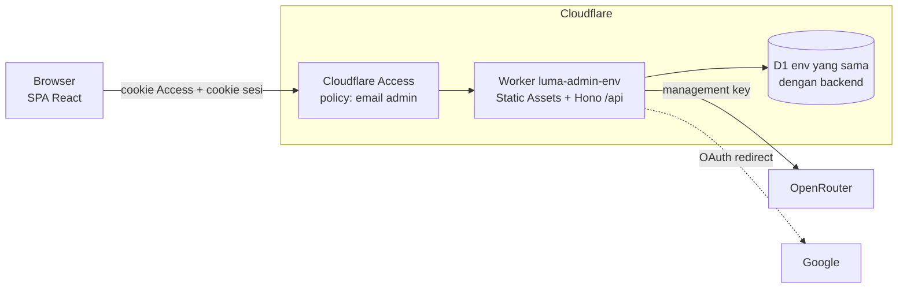
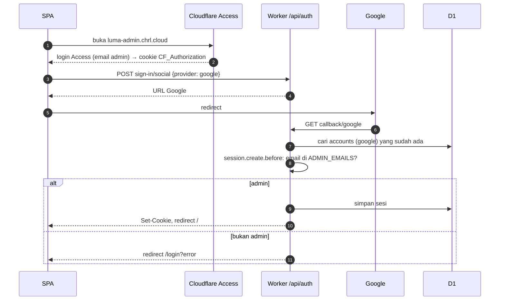

# Dashboard admin (web)

> Kode di `apps/dashboard` (API dulu; SPA menyusul). Urutan issue dan checklist: induk [#216](https://github.com/choiruladamm/luma/issues/216).

Pengganti kerjaan admin yang sekarang lewat terminal (`make backend-invite`, `make backend-ban`, query `wrangler d1 execute` manual). Cuma dipakai pemilik app. Backend `/v1` dan app mobile tidak berubah.

## Scope MVP

| Layar | Isi |
|---|---|
| Login | Tombol masuk Google. Email di luar daftar admin ditolak |
| Ringkasan | Jumlah user (total, baru 7 hari, di-ban), total R2 dan data sync, baris sync ditulis hari ini vs batas D1 100rb, kode undangan belum dipakai, status saklar darurat (`SYNC_ENABLED`, `BACKUP_ENABLED`, `AI_KEY_ENABLED`, cuma ditampilkan) |
| User | Daftar user, cari email atau nama (bagian mana pun, paling cocok dulu), filter (status, key AI, aktivitas), urut per kolom, nomor halaman 25/50 ([#224](https://github.com/choiruladamm/luma/issues/224)) |
| Detail user | Data user, sesi per device, pemakaian key AI subsidi, kode undangan yang dipakai, tombol ban / unban |
| Undangan | Bikin 1–20 kode, daftar belum/sudah dipakai (oleh siapa, kapan), copy, hapus kode yang belum dipakai |

Prinsip:

- **Cuma metadata.** Tidak ada endpoint yang membaca isi `records` (buku, chat, terjemahan) atau file di R2.
- **Ban = cabut AI subsidi saja**, sama dengan `make backend-ban` (docs/backend.md, Batas & pengaman). Login, backup, dan sync user tetap jalan. Unban = `banned = 0`; key baru dibuat lazy saat app minta lagi.
- Saklar darurat tetap `vars` + deploy. Toggle dari dashboard butuh `killSwitch` baca D1/KV tiap request, padahal saklar harus jalan sebelum D1 disentuh.

Tidak masuk MVP: hapus user (tetap lewat `DELETE /v1/me` dari app), revoke sesi, impersonate, toggle saklar, analytics Cloudflare (request/hari, CPU p99), pemakaian AI per user di daftar user.

Spend workspace OpenRouter di Ringkasan dari `GET /activity?workspace_id=` OpenRouter: menghitung key yang sudah dihapus (ban, rotasi), beda dengan menjumlah key yang masih hidup. Cuma hari UTC yang sudah lewat (spend "sampai kemarin") dan 30 hari terakhir. Budget dari `AI_MONTHLY_BUDGET_USD` backend, yang harus sama dengan guardrail workspace; guardrail sendiri tidak punya angka pemakaian. Spend gak di-cache di Worker: Cache API gak tersedia untuk Worker di belakang Cloudflare Access, jadi tiap buka Ringkasan = 1 subrequest.

## Arsitektur



| Bagian | Pilihan |
|---|---|
| Lokasi | `apps/dashboard`, Worker sendiri, bukan route di Worker backend: endpoint admin tidak ikut ke API publik `/v1` |
| Domain | `luma-admin.chrl.cloud` (prod), `luma-admin-dev.chrl.cloud` (dev). Satu deploy per env; prod hanya dari `master` |
| Akses | Cloudflare Access (self-hosted application per hostname) di depan Worker. `workers_dev: false` dan `preview_urls: false`, jadi custom domain di belakang Access satu-satunya jalan masuk |
| Frontend | Vite + React SPA di `client/`, disajikan Workers Static Assets dari Worker yang sama (satu origin, tanpa CORS). React Router untuk routing: tiap layar chunk sendiri (`lazy`), dan loader route cuma memulai query layar itu bareng unduhan chunk-nya tanpa menahan navigasi. Data lewat TanStack Query di atas klien `hc<AppType>()` Hono RPC (tipe request/response ikut Worker, header JSON global); login/logout `fetch` biasa ke `/api/auth/*`. Form RHF + `zod/mini` (zod penuh dua pertiga chunk User), tabel TanStack Table (mode manual, paginasi di server), Zustand cuma untuk state UI (bukan data API). Copy Indonesia/English tanpa library i18n (lihat UI). Tanpa Axios |
| API | Hono di `/api/*`, zod validator, error `{"error": {"code", "message"}}` seperti backend |
| Data | Binding D1 ke database yang sama dengan backend env itu. Tidak pakai R2 |
| Styling | Tailwind v4 dengan token Stabilo di `client/styles/app.css` (terang dari board "14 · Admin web", gelap dari token gelap Stabilo app). Font Bricolage Grotesque (cuma sumbu `wght`) / Geist / Geist Mono di-bundle (`@fontsource`, CSP gak izinkan Google Fonts). Ikon Hugeicons stroke-rounded, set yang sama dengan app |

Routing Static Assets: request `/api/*` masuk Worker, sisanya file statis dengan fallback `index.html`. React ditambahkan ke proyek Vite `apps/dashboard` yang sudah ada (`react()` sebelum `cloudflare()` di `vite.config.ts`, `index.html` di root `apps/dashboard`), bukan proyek Vite baru di `client/`.

```jsonc
"assets": {
  // Tanpa "directory": plugin Vite Cloudflare mengarahkannya ke hasil build client.
  "not_found_handling": "single-page-application",
  "run_worker_first": ["/api/*"]
}
```

Struktur:

```
apps/dashboard/
├── wrangler.jsonc        # env dev/prod, D1, rate limit, vars ADMIN_EMAILS
├── vite.config.ts        # @cloudflare/vite-plugin (+ @vitejs/plugin-react saat SPA)
├── backend-vars.ts       # baca var backend (saklar, workspace OpenRouter, budget) dari apps/backend/wrangler.jsonc
├── worker/               # API, pola sama dengan apps/backend/src
│   ├── index.ts          # urutan middleware + mount route; export type AppType
│   ├── env.ts            # AppEnv + createFactory
│   ├── backend-env.d.ts  # tipe var backend yang disuntik
│   ├── auth/             # instance Better Auth, isAdmin, query sesi
│   ├── middleware/       # requestId, header keamanan, rate limit, requireAdmin, cek mutasi, validate
│   ├── lib/              # errors, audit
│   └── features/         # users/, invites/, overview/: routes.ts + service.ts + repo.ts
├── index.html            # entry SPA → client/main.tsx
├── public/_headers       # CSP + nosniff untuk file statis (gak lewat Worker), `/assets/*` immutable 1 tahun (nama file ber-hash)
├── tsconfig.client.json  # client/: DOM + JSX
└── client/               # SPA, file kebab-case; cuma import tipe dari worker/
    ├── main.tsx
    ├── app/              # router, providers, query-client (setelan free tier), require-session
    ├── lib/              # api-client (hc), api-error, env (badge DEV), format
    ├── i18n/             # copy id.ts (sumber) + en.ts (chunk sendiri), useI18n
    ├── hooks/            # hook generik: use-debounce, use-media-query, use-copy-to-clipboard
    ├── stores/           # Zustand, state UI saja
    ├── features/<fitur>/ # auth, overview, users, invites
    │   ├── api/          # panggilan hc mentah → data atau ApiError
    │   ├── queries/      # useQuery/useMutation + query-keys.ts
    │   ├── hooks/        # logika client khusus fitur (gak panggil API)
    │   ├── schemas/      # zod untuk form
    │   ├── components/   # tampilan, cuma terima props
    │   └── pages/        # satu file per layar
    ├── components/       # layout + ui (foundation Stabilo)
    └── styles/           # token Stabilo
```

### Kode bersama dengan backend

Backend pemilik schema; dashboard cuma konsumen. Diimport relatif dari `../backend/src`:

| File | Dipakai untuk |
|---|---|
| `db/schema.ts` | Tabel Drizzle |
| `db/client.ts` | `createDb` (Drizzle D1, `casing: "snake_case"`) |
| `auth/user-fields.ts` | `additionalFields` Better Auth, supaya schema sama persis |
| `auth/invite.ts` | `newInviteCode`, `normalizeInviteCode` |
| `clients/openrouter.ts` | `deleteKey`, `getUsage`, `OPENROUTER_API` (`/activity` di Ringkasan) |
| `lib/encoding.ts` | `DAY_MS` (hari UTC `sync_day`, sama dengan backend) |

Test dashboard juga membaca `features/ai-key/repo.ts` (`findUserKey`, yang dibaca `issueKey`) untuk memastikan unban membuka AI lagi. Migrasi D1 hanya dibuat di backend. Test dashboard menerapkan `../backend/migrations`, jadi perubahan schema yang merusak dashboard ketahuan di `make dashboard-test`.

Script `apps/backend/scripts/invite.ts` dan `ban.ts` tetap ada sebagai cadangan kalau dashboard atau login Google bermasalah, ditambah `unban.ts` (`make backend-unban`) supaya cadangan terminal lengkap.

## Auth & role

Dua lapis:

1. **Cloudflare Access** (edge): policy cuma mengizinkan email admin, login lewat one-time PIN email (atau Google kalau IdP-nya ditambah). Request tanpa lolos Access tidak pernah sampai Worker, jadi tidak memakai kuota Workers maupun D1. Lapis ini cuma menyaring traffic; JWT Access (`Cf-Access-Jwt-Assertion`) tidak diverifikasi di Worker karena tanpa `workers.dev` dan preview URL tidak ada jalan yang melewati Access.
2. **Better Auth** (Worker): sesi dan keputusan siapa admin. Tetap fail closed sendiri, jadi Access yang salah konfigurasi atau dimatikan tidak membuka dashboard.

Satu role: **admin**, ditentukan lewat `vars` `ADMIN_EMAILS` (dipisah koma) per env. Tanpa kolom `role`, tanpa migrasi. Role kedua (mis. cuma baca) nanti cukup `VIEWER_EMAILS`.

| | User Luma | Admin |
|---|---|---|
| Masuk lewat | App mobile, `/v1/auth` | Dashboard, `/api/auth` |
| Sesi | Bearer token | Cookie httpOnly, Secure, SameSite=Lax, 12 jam |
| Baris `users` | Sama | Sama (akun Google yang dipakai di app) |

Dashboard menjalankan **instance Better Auth kedua** di D1 yang sama:

- `basePath: "/api/auth"`, Google OAuth redirect (web client ID yang sudah ada di `GOOGLE_CLIENT_IDS`), tanpa plugin `bearer`, `BETTER_AUTH_SECRET` sendiri. Token sesi app mobile tidak bisa dipakai di dashboard.
- `databaseHooks.user.create.before` selalu menolak: dashboard tidak bisa membuat akun.
- `databaseHooks.session.create.before` menolak email di luar `ADMIN_EMAILS`: user biasa tidak pernah dapat cookie.
- Sesi 12 jam dan tidak diperpanjang (`disableSessionRefresh`). Error di callback (bukan admin, akun belum ada) redirect ke `/login?error=FORBIDDEN&error_description=...` (`onAPIError.errorURL`), bukan halaman error Better Auth.
- Middleware `requireAdmin` mengecek email lagi di tiap `/api/*` (selain `/api/auth/*`).
- Endpoint Better Auth di-allowlist: `GET get-session`, `POST sign-in/social`, `GET callback/google`, `POST sign-out`. Sisanya 404.

**Plugin admin Better Auth tidak dipakai.** Kolom `banned` miliknya memblokir login dan mencabut sesi, sedangkan `users.banned` Luma cuma mencabut AI subsidi. Plugin itu juga menambah `role`, `banReason`, `banExpires`, `impersonatedBy`, dan endpoint `/admin/*` yang tidak dibutuhkan.

Alur login:



Alur di `client/` satu arah: `pages → (hooks fitur + queries) → api → lib/api-client`. Fitur gak saling import. TanStack Query disetel untuk free tier: tanpa refetch saat fokus jendela, tanpa polling, retry 1 kali cuma untuk error server/jaringan, `staleTime` 60 detik; 401 di mana pun → `/login`. Loader route pakai query yang sama dengan layarnya, jadi prefetch gak menambah request. Pindah layar mulai dari atas halaman, tombol back balik ke posisi scroll sebelumnya. Habis ban/unban, cache user di-invalidasi; angka Ringkasan ikut berubah setelah cache-nya basi.

## Endpoint

Urutan middleware: `requestId → rateLimit per IP → [/api/auth/* → Better Auth] → sesi cookie + requireAdmin → cek mutasi (JSON + `Origin`) → rate limit per admin (mutasi) → validator → handler`, `onError` di luar. Header CSP dan `nosniff` dipasang di semua respons. Sesi cookie dicek tanpa membangun instance Better Auth (mahal CPU): tanda tangan HMAC dulu, lalu 1 query join `sessions` + `users`.

| Endpoint | Request | Respons | D1 / subrequest |
|---|---|---|---|
| `GET /api/overview` | - | `{users: {total, new7d, banned}, storage: {r2Bytes, syncBytes}, syncToday: {rows, limit: 100000}, invites: {unused}, flags: {sync, backup, aiKey}, ai: {spendUsd, budgetUsd, asOf}}`. `syncToday.rows` = `SUM(sync_rows)` untuk `sync_day` hari ini (UTC). `ai.spendUsd` bulan UTC ini sampai `asOf` (kemarin); OpenRouter gagal → `null`, tetap 200 | 1 `batch` 3 agregat + 1 subrequest OpenRouter (`/activity`); `flags` dari `env` |
| `GET /api/users?q=&status=&ai=&activity=&sort=&dir=&page=&limit=50` | `q` dicari di email atau nama, bagian mana pun, tanpa beda huruf besar/kecil. `status` `active`/`banned`, `ai` `yes`/`no` (key subsidi), `activity` `7d`/`30d`/`never` (sesi terakhir). `sort` `created`/`lastActive`/`r2`/`sync`/`relevance`, `dir` `desc` (default)/`asc`, `page` ≥ 1, `limit` ≤ 50 | `{items: [{id, email, name, createdAt, lastActiveAt, banned, hasAiKey, r2Bytes, syncBytes}], total, page, pageCount}`. `sort` default: `relevance` kalau ada `q` (0 email persis, 1 awalan email, 2 awal kata: setelah `.` `_` `-` `@` di email atau kata di nama, 3 sisanya), selain itu `created`. Seri: terbaru lalu `id`. `lastActive` yang belum pernah aktif selalu di akhir. Halaman lewat batas → `items` kosong | 1 `batch` 2 statement: halaman (`users` ⟕ `user_storage` ⟕ `ai_keys`, `lastActiveAt` subquery `MAX(sessions.updated_at)` per baris, `LIMIT/OFFSET`) + `COUNT` dengan filter yang sama |
| `GET /api/users/:id` | - | data di atas + `sessions: [{userAgent, ipAddress, createdAt, updatedAt}]` (maks 50, terbaru dulu), `ai: {limit, usageDaily, expiresAt} \| null`, `invite: {code, usedAt} \| null`, `providers` (id provider Better Auth: `google`, `credential`). `getUsage` gagal → tetap 200 dengan `usageDaily: null` | 1 `batch` (5 statement) + 1 subrequest OpenRouter (`getUsage`) kalau punya key |
| `POST /api/users/:id/ban` | - | `{banned: true, keyRevoked}` | 1 query (user + hash key), `deleteKey` OpenRouter dulu (404 = sudah hilang, dianggap sukses); gagal → 502 tanpa menyentuh D1. Sukses → 1 `batch` (`banned = 1` + hapus `ai_keys`). Idempoten |
| `POST /api/users/:id/unban` | - | `{banned: false}` | 1 update (`RETURNING`, user gak ada → 404) |
| `GET /api/invites?status=&usedWithin=&q=&sort=&dir=&page=&limit=20` | `status` `unused`/`used`, `usedWithin` `7d`/`30d` (cuma kode terpakai), `q` kode (tanpa beda huruf/strip) atau email pemakai di bagian mana pun, `sort` `default`/`createdAt`/`usedAt`/`code`, `dir`, `page` ≥ 1, `limit` ≤ 50 ([#225](https://github.com/choiruladamm/luma/issues/225)) | `{items: [{code, createdAt, usedBy: {id, email} \| null, usedAt}], total, page, pageCount, counts: {all, unused, used}}`. Terpakai = `used_at` terisi (`usedBy` bisa `null` kalau akunnya dihapus). Kode ditampilkan `LUMA-XXXXX-XXXXX`. `default`: belum dipakai dulu (terbaru dibuat di atas), lalu terbaru dipakai; `usedAt`: yang belum dipakai selalu di akhir; `createdAt`: kode tanpa tanggal selalu di akhir. `createdAt` `null` = kode dibuat sebelum kolom `invite_codes.created_at` ada (kolomnya nullable karena `ADD COLUMN` SQLite gak bisa default "sekarang"; insert lewat Drizzle mengisinya, script `make backend-invite` mengisinya sendiri). `counts` cuma ikut `q` (angka tab), `total` ikut semua filter | 1 `batch` 2 statement: halaman (`invite_codes` ⟕ `users`, `LIMIT/OFFSET`) + hitungan per status |
| `POST /api/invites` | `{count: 1..20}` | 201 `{codes: [...], createdAt}` (tanggal yang disimpan, tampil di dialog) format `LUMA-XXXXX-XXXXX` (disimpan ternormalisasi, sama dengan `make backend-invite`) | 1 insert |
| `DELETE /api/invites/:code` | - | 204 | `DELETE … WHERE used_at IS NULL` (kode dinormalisasi dulu); gagal → +1 query: ada → 409 `INVITE_CODE_USED`, gak ada → 404 |

Kode error: `BAD_REQUEST` 400 (validasi zod), `UNAUTHORIZED` 401, `FORBIDDEN` 403, `NOT_FOUND` 404, `INVITE_CODE_USED` 409, `RATE_LIMITED` 429 (+ `Retry-After`), `INTERNAL_ERROR` 500, `OPENROUTER_FAILED` 502.

## Keamanan

Dashboard memakai D1 dan kuota Workers yang sama dengan backend, jadi selain membobol akses, penyerang juga bisa menghabiskan kuota dan ikut menjatuhkan app mobile.

| Ancaman | Pengaman |
|---|---|
| Akses `/api` tanpa login / bukan admin | `requireAdmin` dipasang **global** di `/api/*` (kecuali `/api/auth/*`), bukan per route, jadi route baru otomatis terlindungi. Test integrasi mengiterasi semua route terdaftar: tanpa cookie → 401, cookie user non-admin → 403 |
| Daftar admin salah konfigurasi | **Fail closed**: `ADMIN_EMAILS` kosong/tidak diisi = semua ditolak. Email dibandingkan per item setelah `trim().toLowerCase()`, pencocokan persis (bukan `includes` pada string mentah). Wajib `emailVerified` |
| Token sesi app mobile dipakai di dashboard | Tidak ada plugin `bearer`. Cookie ditandatangani `BETTER_AUTH_SECRET` dashboard (beda dari backend), jadi token dari tabel `sessions` saja tidak cukup |
| Login dengan cara lain | Instance dashboard cuma mengaktifkan Google (tanpa email/password, walau env dev backend mengaktifkannya). `user.create.before` selalu menolak |
| Banjir request dari luar (termasuk `sign-in/social`, yang menulis state OAuth) | Cloudflare Access menolak di edge sebelum Worker, jadi kuota Workers dan D1 backend tidak tersentuh. Lapis kedua: `account.storeStateStrategy: "cookie"` (state OAuth di cookie terenkripsi, tidak menulis D1), cookie tidak ada → 401 tanpa D1, rate limit per IP |
| Jalan masuk yang melewati Access | `workers_dev: false`, `preview_urls: false`; Worker cuma terpasang di custom domain yang dilindungi Access |
| Access salah konfigurasi atau dimatikan | Better Auth tetap memeriksa sesi dan `ADMIN_EMAILS` (fail closed); yang hilang cuma perlindungan kuota di edge |
| CSRF | Cookie SameSite=Lax. Mutasi wajib `content-type: application/json` dan header `Origin` harus domain dashboard (selain itu 403). `trustedOrigins` cuma domain `luma-admin*` |
| XSS (nama/email/user agent user ditampilkan) | React meng-escape teks; `dangerouslySetInnerHTML` dilarang. Header `Content-Security-Policy: default-src 'self'; frame-ancestors 'none'` dan `X-Content-Type-Options: nosniff` untuk semua respons: respons Worker lewat middleware, file statis SPA lewat `public/_headers` (Static Assets gak lewat Worker) |
| Clickjacking tombol ban | `frame-ancestors 'none'` |
| Input jahat | zod di semua input: `:id` dan `:code` format pasti, `q` maks 100 karakter, dicari dengan `instr()` (bukan `LIKE`: D1 menolak pola `LIKE` di atas 50 byte, dan `%`/`_` gak perlu di-escape), `limit` ≤ 50, `count` 1–20. Query lewat Drizzle (terparameter) |
| Data sensitif bocor lewat respons | Repo memilih kolom eksplisit (tanpa `select *`). `key_enc`, token sesi, dan isi `records` tidak pernah dikirim |
| Admin disalahgunakan / salah klik | Ban dan hapus undangan pakai dialog konfirmasi. Badge DEV/PROD. Rate limit per admin untuk mutasi (30/menit, binding `ADMIN_RATE_LIMITER`). Audit `{admin, action, targetId, requestId}` ke Workers Logs |
| Cookie admin dicuri | httpOnly, Secure, umur 12 jam, sign-out menghapus sesi. Hapus email dari `ADMIN_EMAILS` + deploy → sesi yang masih ada langsung ditolak `requireAdmin` |
| Akun Google admin dibobol | Di luar kode: 2FA di akun Google. Selama app OAuth mode Testing, cuma test user yang bisa login sama sekali |

Secret per env lewat `wrangler secret put`: `BETTER_AUTH_SECRET` (baru, beda dari backend), `GOOGLE_CLIENT_SECRET`, `OPENROUTER_MANAGEMENT_KEY`.

## Free tier

Batas Workers 100rb request/hari dihitung per akun, jadi dashboard ikut memakai kuota backend. Satu kali buka ≈ 3–5 request Worker (file statis tidak dihitung), baris D1 dibaca ≈ 2–3× jumlah user. Tanpa polling dan tanpa auto-refresh; data dimuat saat halaman dibuka atau setelah aksi. Implementasi menambah baris dashboard di anggaran per aksi (docs/backend.md, Aturan free tier).

## UI

- Copy Indonesia dan English, light dan dark mengikuti sistem (lihat Bahasa di bawah).
- Responsif sampai lebar HP (±360px): di bawah 768px tabel berubah jadi daftar kartu (bergaris tepi tipis), navigasi pindah ke tab bar bawah, dialog jadi bottom sheet (menempel di bawah, tombol konfirmasi sama lebar, tanpa hint Esc), judul halaman dan tombol utamanya satu baris dengan waktu data di bawahnya, profil Detail user memadat (avatar di samping email, email pindah baris di `@`, fakta 2 kolom, kartu File buku dan Data sync berdampingan), dan filter Undangan dibagi rata selebar baris dengan label pendek ("Belum" / "Udah"). Menu yang meredupkan halaman di HP (menu akun, search) mengunci scroll halaman.
- Badge **DEV** di header kalau env bukan prod, supaya tidak salah ban di prod.
- Board: halaman "14 · Admin web" di Stabilo (komponen 1 & 2, Ringkasan, User, Detail user + dialog ban + udah di-ban, Undangan + kode baru, tampilan HP, menu burger, loading). Bahasa (Indonesia/English) dan tema Terang/Gelap/Sistem di menu akun, pilihan disimpan di browser.
- Beda dari board karena data atau produk:
  - Ban cuma mencabut AI subsidi, jadi copy "gak bisa masuk atau sync" diganti "Kuota AI gratisnya dicabut. Masuk, backup, dan sync tetap jalan".
  - Kartu Sync cuma hari ini (backend gak nyimpan riwayat per hari), bukan grafik 7 hari.
  - Key AI: "Kuota gratis" kalau punya key subsidi, selain itu "—"; key sendiri gak pernah sampai server.
  - Navigasi HP: tab bar melayang di bawah (ikon, label, jumlah) menggantikan menu burger (board 11), jadi pindah layar cukup satu tap. Header HP tinggal logo, titik DEV, search, dan avatar. Di 768–1023px tab header cuma ikon (label muncul sebagai tooltip saat hover/fokus) dan search masih tombol ikon; mulai 1024px tab berlabel dan search jadi kolom penuh. Header selalu satu baris, jadi menu akun gak pernah keluar layar.
  - Tanpa tanggal ban (gak ada kolom `banned_at`). Undangan punya kolom "Dibuat" yang gak ada di board; kode lama tanpa tanggal tampil "—".
  - Tambahan: layar Login, kartu Perangkat (sesi) dan Kuota AI gratis di Detail user, kartu Kuota AI gratis (spend bulan ini) di Ringkasan, dialog konfirmasi hapus kode.
- Tabel User: filter Status, Key AI, Aktivitas lewat tombol Filter (panel kecil di desktop, bottom sheet berisi filter dan urutan di HP; di HP tombolnya ikon di samping search), chip Urutkan di desktop (urutan + arah sekali pilih, mis. "Terlama daftar"), filter aktif tampil sebagai chip yang bisa dihapus satu-satu + "Reset semua". Dropdown pakai komponen `Select` sendiri (menu ala menu akun, buka ke atas kalau ruang bawah kurang), bukan `<select>` native. Klik header kolom juga mengurutkan (klik lagi balik arah), nomor halaman di footer ("51–100 dari 120", ‹ 1 … 4 5 6 … 10 ›, 25/50 per halaman; HP "Hal 2 / 3"). Semua state di URL (`?q=&status=&sort=&dir=&page=`), ganti filter/urut balik ke halaman 1. Tabel Undangan (di server, sama dengan User): tab status dengan jumlah (desktop: tab garis bawah di atas kartu; HP: segmented), di bawahnya search kode (dengan/tanpa strip) atau email (debounce 300 ms) dan chip "Dipakai dalam" 7/30 hari (otomatis pindah ke tab "Udah dipakai"; tab "Belum dipakai" menghapusnya), chip Urutkan (belum dipakai dulu, terbaru/terlama dibuat, terbaru/terlama dipakai, kode A–Z/Z–A) dan header Kode/Dibuat/Tanggal dipakai, nomor halaman 20/50, state di URL. Beda dari board (komponen 2: "Muat lagi", bukan nomor halaman) karena admin perlu lompat ke halaman tertentu dan melihat total hasil filter.
- Error: layar yang crash menampilkan kartu error di dalam shell (header dan nav tetap jalan) dengan "Muat ulang", "Ke Ringkasan", dan detail teknis; tab yang masih memakai file versi lama setelah deploy diminta muat ulang; alamat yang gak dikenal → "Halaman gak ditemukan"; shell atau login yang crash → kartu di tengah halaman.
- Login: balik dari Google pakai tombol back (halaman dipulihkan dari cache browser) mengembalikan tombol masuk ke keadaan normal, bukan loading terus.
- Loading: tata letak asli langsung tampil (judul, label, header kolom), angka dan baris diganti skeleton (board loading), bukan layar loading terpisah. Undangan dan Detail user gak punya board loading, jadi ikut aturan yang sama; di HP tabel yang lagi muat tampil sebagai kartu, sama dengan tabel aslinya. Jumlah di filter Undangan ikut skeleton, bukan "0".
- Waktu ditampilkan di zona waktu browser admin.
- Cari email di header (combobox): `/` fokus ke kolom; minimal 2 huruf, setelah jeda 300 ms muncul 5 user paling cocok (email atau nama, bagian yang cocok disorot stabilo pink) plus "Lihat semua hasil" ke `/users?q=`. Input dinormalisasi (trim, huruf kecil, buang `mailto:`). Panah + Enter buka user; Enter pada email persis langsung buka user itu; Esc tutup lalu kosongkan. Query sama dengan halaman User, jadi pindah ke daftar pakai cache. Disembunyikan di `/users` (halaman itu punya kolom cari sendiri); di bawah 1024px jadi tombol ikon yang mengganti isi header dengan kolom cari + tombol tutup (halaman diredupkan dan gak bisa di-scroll).
- Tab (nav desktop, Segmented) punya pill aktif dan pill hover yang meluncur (`useSlidingPill`), tanpa animasi kalau browser minta kurangi gerakan.
- Nav melayang (mulai 768px): header gak sticky; begitu header lewat dari layar, kapsul nav ringkas (logo, tab, search, menu akun) turun dari atas dan naik lagi saat header kelihatan. Cuma salinan yang terlihat yang aktif (menu akun, shortcut `/`); yang tersembunyi `inert` + `aria-hidden`. Saat mode search (di bawah 1024px) nav melayang gak muncul.
- Pindah layar dari nav pakai View Transitions: isi halaman crossfade, nav meluncur dari kapsul melayang ke header (nama transisi `main-nav`); browser tanpa dukungan pindah biasa, dan gerakan dimatikan kalau diminta.
- Paginasi gak melompat ke atas halaman: ganti halaman menggulir halus ke awal tabel (di bawah nav melayang), dan diam kalau awal tabel sudah terlihat. Panah di halaman pertama/terakhir tampil pudar.

### Bahasa

Aturan copy sama dengan app mobile (docs/i18n.md): Indonesia mengikuti board, English santai, jelas, natural; nama app, model, dan provider tetap. Bedanya cuma default.

- Default ikut browser: `navigator.language` diawali `en` → English, bahasa lain → Indonesia. Pilihan di menu akun (segmented Indonesia / English, nama bahasa gak diterjemahkan) langsung berlaku tanpa Simpan dan disimpan di localStorage bareng tema; habis itu pilihan menang atas bahasa browser.
- Login gak punya pemilih bahasa (gak ada di board); ikut pilihan tersimpan atau browser.
- Copy di `client/i18n`: `id.ts` sumber dan bentuknya jadi tipe `Messages`, `en.ts` wajib cocok (key hilang, key lebih, atau parameter beda → `tsc` gagal). Kalimat dinamis berupa fungsi bertipe; plural English lewat `Intl.PluralRules`. Tanpa library.
- `en.ts` chunk sendiri yang diunduh sebelum render pertama (gak berkedip Indonesia), atau diunduh diam-diam saat halaman idle supaya ganti bahasa pertama kali gak nunggu jaringan. File statis, jadi gak menambah request Worker; gagal diunduh → tetap Indonesia. `<html lang>` ikut bahasa yang tampil.
- Error API diterjemahkan di client dari `code` (`t.errors`); `message` dari Worker berbahasa Inggris dan cuma buat log, Worker gak tahu bahasa UI.
- Angka, ukuran, uang, dan tanggal pakai locale bahasa itu (`id-ID` / `en`): "1,5 KB" / "1.5 KB", "14 Nov 2026" / "Nov 14, 2026". Waktu relatif pakai copy sendiri ("2 mnt lalu" / "2 mins ago").
- Data user (nama, email, user agent, kode undangan) gak diterjemahkan.

Prompt Claude Design (detail visual diserahkan ke Claude Design, mengikuti foundation Stabilo):

> Dashboard admin web untuk Luma, satu admin, bahasa Indonesia, light + dark, desktop dan HP. Pakai foundation Stabilo.
>
> **Layar Ringkasan.** Kartu angka: jumlah user (total, baru 7 hari, di-ban), total penyimpanan file dan data sync, baris sync ditulis hari ini dibanding batas harian 100.000, jumlah kode undangan yang belum dipakai. Status tiga saklar layanan (Sync, Backup, Key AI): nyala/mati, cuma tampilan. Navigasi ke User dan Undangan. Badge DEV di header untuk env dev.
>
> **Layar User.** Kolom cari email, daftar user: email, nama, tanggal daftar, terakhir aktif, penyimpanan file, data sync, punya key AI atau tidak, status di-ban. Paginasi "Muat lagi". Klik baris ke detail user. Di HP, baris jadi kartu. State kosong (belum ada user / hasil cari kosong) dan loading.

## Setup & deploy

Urutan per env (dev sudah jalan; prod saat deploy dari `master`):

1. **Google Cloud Console**, web client OAuth (yang sama dengan entri pertama `GOOGLE_CLIENT_IDS` backend): redirect URI `https://luma-admin-dev.chrl.cloud/api/auth/callback/google`, `https://luma-admin.chrl.cloud/api/auth/callback/google`, `http://localhost:5173/api/auth/callback/google`. Admin terdaftar sebagai test user selama app OAuth mode Testing.
2. **Cloudflare Zero Trust** (Access controls), **sebelum deploy pertama** supaya custom domain tidak pernah terbuka tanpa Access: login method One-time PIN, policy Allow berisi email admin, aplikasi self-hosted per hostname (`luma-admin-dev.chrl.cloud` / `luma-admin.chrl.cloud`, path kosong), session duration aplikasi 168h (OTP seminggu sekali; sesi dashboard sendiri tetap 12 jam). Cek: request tanpa login → 302 ke `<team>.cloudflareaccess.com`. Halaman login Access (sekali per akun, Reusable components → Custom pages → Access login page): nama organisasi "Luma", latar `#F2EDDD`, teks `#1A1A1A`, footer "Khusus admin Luma" (tanpa header: `header_text` tampil sebagai kotak abu), logo dari bucket R2 publik `luma-brand` di `https://luma-brand.chrl.cloud/luma-logo.svg` (sumbernya `apps/dashboard/brand/luma-logo.svg`; bucket ini cuma berisi aset brand, bukan file user; URL `r2.dev` dimatikan karena diblokir sebagian ISP Indonesia). HTML penuh untuk halaman ini butuh plan Zero Trust berbayar; melewati halaman ini lewat Google IdP + instant authentication ditunda ([#226](https://github.com/choiruladamm/luma/issues/226)).
3. **`ADMIN_EMAILS`** di `wrangler.jsonc` env itu: akun Google yang sudah ada di D1 env itu (dashboard tidak bisa membuat akun).
4. **Deploy**: `make dashboard-deploy e=<env>`. D1 tidak perlu migrasi tersendiri; migrasi backend (`make backend-migrate`) yang berlaku.
5. **Secret** (`bunx wrangler secret put <NAMA> --env <env>` dari `apps/dashboard`): `BETTER_AUTH_SECRET` (acak baru, beda dari backend), `GOOGLE_CLIENT_SECRET` (web client), `OPENROUTER_MANAGEMENT_KEY` (management key workspace OpenRouter env itu).
6. **Cek**: login OTP Access → `/api/auth/get-session` = `null`; login Google admin → sesi 12 jam; `/api/overview` cocok dengan query manual `wrangler d1 execute`.

## Lingkungan lokal

- `make dashboard-dev`: Vite dev server (`@cloudflare/vite-plugin`) yang menjalankan Worker di `http://localhost:5173`; SPA nanti ikut di server yang sama. D1 lokal memakai state wrangler yang sama dengan `make backend-dev` (`persistState` ke `apps/backend/.wrangler/state`), jadi data lokalnya sama. Var backend yang dibaca dashboard (`SYNC_ENABLED`, `BACKUP_ENABLED`, `AI_KEY_ENABLED`, `OPENROUTER_WORKSPACE_ID`, `AI_MONTHLY_BUDGET_USD`) diambil dari `apps/backend/wrangler.jsonc` env yang sama saat dev, build, dan test (`apps/dashboard/backend-vars.ts`), jadi satu sumber; saklar backend yang diubah baru terlihat di dashboard setelah dashboard di-deploy ulang. Secret dan `ADMIN_EMAILS` / `BETTER_AUTH_URL` lokal di `apps/dashboard/.dev.vars` (salin dari `.dev.vars.example`); login Google lokal butuh `GOOGLE_CLIENT_SECRET` terisi.
- Cloudflare Access tidak ada di lokal; Better Auth tetap jalan, jadi perilaku auth sama kecuali lapis edge.
- Login Google lokal: tambah redirect URI `http://localhost:5173/api/auth/callback/google` di web client Google Cloud Console. App OAuth masih mode Testing ([#215](https://github.com/choiruladamm/luma/issues/215)); admin terdaftar sebagai test user.
- Target Makefile: `dashboard-install`, `dashboard-dev`, `dashboard-test` (`tsc` worker + client, vitest worker di workerd + client di happy-dom), `dashboard-e2e` (Playwright di Chrome terpasang, env lokal `e2e` dengan D1 sendiri yang di-seed tiap run), `dashboard-deploy e=dev|prod` (`CLOUDFLARE_ENV=<env> vite build` lalu `wrangler deploy` dengan config hasil build; prod hanya dari `master`).

## Urutan kerja

API dulu, SPA menunggu foundation Stabilo dan board desain. Induk [#216](https://github.com/choiruladamm/luma/issues/216):

1. Scaffold Worker + auth admin (Better Auth + Cloudflare Access) ([#217](https://github.com/choiruladamm/luma/issues/217)); anak lain bergantung ke sini.
2. API user + ban/unban, `make backend-unban` ([#218](https://github.com/choiruladamm/luma/issues/218)).
3. API kode undangan ([#219](https://github.com/choiruladamm/luma/issues/219)).
4. API ringkasan + spike spend workspace OpenRouter ([#220](https://github.com/choiruladamm/luma/issues/220)).
5. SPA React + layar ([#221](https://github.com/choiruladamm/luma/issues/221)).
6. Fondasi i18n Indonesia/English + pilihan Bahasa ([#222](https://github.com/choiruladamm/luma/issues/222)).
7. Terjemahan layar Ringkasan, User, Detail user, Undangan ([#223](https://github.com/choiruladamm/luma/issues/223)).
