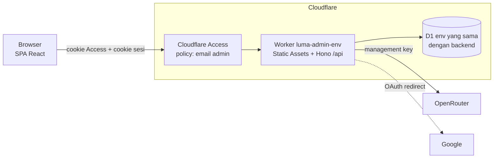
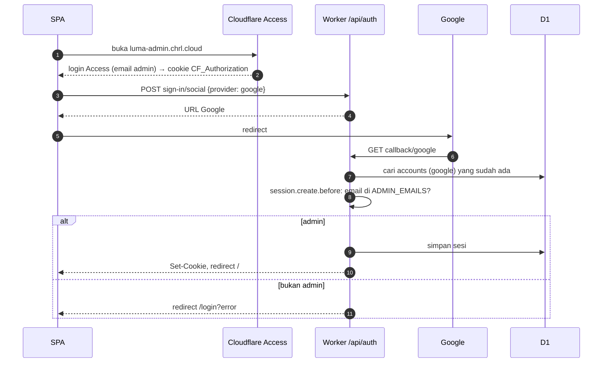

# Dashboard admin (web)

> Kode di `apps/dashboard` (belum dibuat). Urutan issue dan checklist: induk [#216](https://github.com/choiruladamm/luma/issues/216).

Pengganti kerjaan admin yang sekarang lewat terminal (`make backend-invite`, `make backend-ban`, query `wrangler d1 execute` manual). Cuma dipakai pemilik app. Backend `/v1` dan app mobile tidak berubah.

## Scope MVP

| Layar | Isi |
|---|---|
| Login | Tombol masuk Google. Email di luar daftar admin ditolak |
| Ringkasan | Jumlah user (total, baru 7 hari, di-ban), total R2 dan data sync, baris sync ditulis hari ini vs batas D1 100rb, kode undangan belum dipakai, status saklar darurat (`SYNC_ENABLED`, `BACKUP_ENABLED`, `AI_KEY_ENABLED`, cuma ditampilkan) |
| User | Daftar user, cari pakai awalan email, paginasi 50 |
| Detail user | Data user, sesi per device, pemakaian key AI subsidi, kode undangan yang dipakai, tombol ban / unban |
| Undangan | Bikin 1–20 kode, daftar belum/sudah dipakai (oleh siapa, kapan), copy, hapus kode yang belum dipakai |

Prinsip:

- **Cuma metadata.** Tidak ada endpoint yang membaca isi `records` (buku, chat, terjemahan) atau file di R2.
- **Ban = cabut AI subsidi saja**, sama dengan `make backend-ban` (docs/backend.md, Batas & pengaman). Login, backup, dan sync user tetap jalan. Unban = `banned = 0`; key baru dibuat lazy saat app minta lagi.
- Saklar darurat tetap `vars` + deploy. Toggle dari dashboard butuh `killSwitch` baca D1/KV tiap request, padahal saklar harus jalan sebelum D1 disentuh.

Tidak masuk MVP: hapus user (tetap lewat `DELETE /v1/me` dari app), revoke sesi, impersonate, toggle saklar, analytics Cloudflare (request/hari, CPU p99), pemakaian AI per user di daftar user.

Spend workspace OpenRouter di Ringkasan menunggu spike: cek ada tidaknya endpoint list key per workspace atau pemakaian guardrail. Kalau tidak ada, kartu ini dibuang.

## Arsitektur



| Bagian | Pilihan |
|---|---|
| Lokasi | `apps/dashboard`, Worker sendiri, bukan route di Worker backend: endpoint admin tidak ikut ke API publik `/v1` |
| Domain | `luma-admin.chrl.cloud` (prod), `luma-admin-dev.chrl.cloud` (dev). Satu deploy per env; prod hanya dari `master` |
| Akses | Cloudflare Access (self-hosted application per hostname) di depan Worker. `workers_dev: false` dan `preview_urls: false`, jadi custom domain di belakang Access satu-satunya jalan masuk |
| Frontend | Vite + React SPA, disajikan Workers Static Assets dari Worker yang sama (satu origin, tanpa CORS). React Router (loader/action) untuk data dan revalidasi setelah aksi. Klien API `hc<AppType>()` dari Hono RPC, jadi tipe request/response ikut Worker |
| API | Hono di `/api/*`, zod validator, error `{"error": {"code", "message"}}` seperti backend |
| Data | Binding D1 ke database yang sama dengan backend env itu. Tidak pakai R2 |
| Styling | Belum diputuskan (Tailwind atau lainnya), menunggu export foundation Stabilo dari Claude Design |

Routing Static Assets: request `/api/*` masuk Worker, sisanya file statis dengan fallback `index.html`.

```jsonc
"assets": {
  "directory": "./dist/client",
  "not_found_handling": "single-page-application",
  "run_worker_first": ["/api/*"]
}
```

Struktur:

```
apps/dashboard/
├── wrangler.jsonc        # env dev/prod, D1, rate limit, vars ADMIN_EMAILS
├── vite.config.ts        # @vitejs/plugin-react + @cloudflare/vite-plugin
├── worker/               # API
│   ├── index.ts          # app + middleware + mount route; export type AppType
│   ├── auth.ts           # instance Better Auth dashboard
│   ├── overview.ts / users.ts / invites.ts   # route + service
│   └── repo.ts           # semua query D1
└── src/                  # SPA
    ├── main.tsx          # React Router
    ├── api.ts            # hc<AppType>()
    └── pages/            # Login, Ringkasan, User, DetailUser, Undangan
```

### Kode bersama dengan backend

Backend pemilik schema; dashboard cuma konsumen. Diimport relatif dari `../backend/src`:

| File | Dipakai untuk |
|---|---|
| `db/schema.ts` | Tabel Drizzle |
| `auth/user-fields.ts` | `additionalFields` Better Auth, supaya schema sama persis |
| `auth/invite.ts` | `newInviteCode`, `normalizeInviteCode` |
| `clients/openrouter.ts` | `deleteKey`, `getUsage` |

Migrasi D1 hanya dibuat di backend. Test dashboard menerapkan `../backend/migrations`, jadi perubahan schema yang merusak dashboard ketahuan di `make dashboard-test`.

Script `apps/backend/scripts/invite.ts` dan `ban.ts` tetap ada sebagai cadangan kalau dashboard atau login Google bermasalah, ditambah `unban.ts` (`make backend-unban`) supaya cadangan terminal lengkap.

## Auth & role

Dua lapis:

1. **Cloudflare Access** (edge): policy cuma mengizinkan email admin, login lewat Google atau one-time PIN email. Request tanpa lolos Access tidak pernah sampai Worker, jadi tidak memakai kuota Workers maupun D1. Lapis ini cuma menyaring traffic; JWT Access (`Cf-Access-Jwt-Assertion`) tidak diverifikasi di Worker karena tanpa `workers.dev` dan preview URL tidak ada jalan yang melewati Access.
2. **Better Auth** (Worker): sesi dan keputusan siapa admin. Tetap fail closed sendiri, jadi Access yang salah konfigurasi atau dimatikan tidak membuka dashboard.

Satu role: **admin**, ditentukan lewat `vars` `ADMIN_EMAILS` (dipisah koma) per env. Tanpa kolom `role`, tanpa migrasi. Role kedua (mis. cuma baca) nanti cukup `VIEWER_EMAILS`.

| | User Luma | Admin |
|---|---|---|
| Masuk lewat | App mobile, `/v1/auth` | Dashboard, `/api/auth` |
| Sesi | Bearer token | Cookie httpOnly, Secure, SameSite=Lax, 12 jam |
| Baris `users` | Sama | Sama (akun Google yang dipakai di app) |

Dashboard menjalankan **instance Better Auth kedua** di D1 yang sama:

- `basePath: "/api/auth"`, Google OAuth redirect (web client ID yang sudah ada di `GOOGLE_CLIENT_IDS`), tanpa plugin `bearer`, `BETTER_AUTH_SECRET` sendiri. Token sesi app mobile tidak bisa dipakai di dashboard.
- `databaseHooks.user.create.before` selalu menolak: dashboard tidak bisa membuat akun.
- `databaseHooks.session.create.before` menolak email di luar `ADMIN_EMAILS`: user biasa tidak pernah dapat cookie.
- Middleware `requireAdmin` mengecek email lagi di tiap `/api/*` (selain `/api/auth/*`).
- Endpoint Better Auth di-allowlist: `GET get-session`, `POST sign-in/social`, `GET callback/google`, `POST sign-out`. Sisanya 404.

**Plugin admin Better Auth tidak dipakai.** Kolom `banned` miliknya memblokir login dan mencabut sesi, sedangkan `users.banned` Luma cuma mencabut AI subsidi. Plugin itu juga menambah `role`, `banReason`, `banExpires`, `impersonatedBy`, dan endpoint `/admin/*` yang tidak dibutuhkan.

Alur login:



## Endpoint

Urutan middleware: `requestId → rateLimit per IP → [/api/auth/* → Better Auth] → sesi cookie → requireAdmin → validator → handler`, `onError` di luar.

| Endpoint | Request | Respons | D1 / subrequest |
|---|---|---|---|
| `GET /api/overview` | - | `{users: {total, new7d, banned}, storage: {r2Bytes, syncBytes}, syncToday: {rows, limit}, invites: {unused}, flags: {sync, backup, aiKey}}` | 1 `batch` ±4 agregat; `flags` dari `env` |
| `GET /api/users?q=&cursor=&limit=50` | `q` awalan email | `{items: [{id, email, name, createdAt, lastActiveAt, banned, hasAiKey, r2Bytes, syncBytes}], nextCursor}` | 1 query: `users` ⟕ `user_storage` ⟕ `ai_keys` ⟕ `MAX(sessions.updated_at)` |
| `GET /api/users/:id` | - | data di atas + `sessions: [{userAgent, ipAddress, createdAt, updatedAt}]`, `ai: {limit, usageDaily, expiresAt} \| null`, `invite: {code, usedAt} \| null` | 1 `batch` + 1 subrequest OpenRouter (`getUsage`) kalau punya key |
| `POST /api/users/:id/ban` | - | `{banned: true, keyRevoked}` | `deleteKey` OpenRouter dulu; gagal → 502 tanpa menyentuh D1. Sukses → 1 `batch` (`banned = 1` + hapus `ai_keys`). Idempoten |
| `POST /api/users/:id/unban` | - | `{banned: false}` | 1 update |
| `GET /api/invites?status=unused\|used` | - | `{items: [{code, usedBy: {id, email} \| null, usedAt}]}` | 1 query |
| `POST /api/invites` | `{count: 1..20}` | `{codes: [...]}` | 1 insert |
| `DELETE /api/invites/:code` | - | 204 | `DELETE … WHERE used_by IS NULL`; sudah dipakai → 409 |

Kode error: `UNAUTHORIZED` 401, `FORBIDDEN` 403, `NOT_FOUND` 404, `INVITE_CODE_USED` 409, `RATE_LIMITED` 429, `OPENROUTER_FAILED` 502.

## Keamanan

Dashboard memakai D1 dan kuota Workers yang sama dengan backend, jadi selain membobol akses, penyerang juga bisa menghabiskan kuota dan ikut menjatuhkan app mobile.

| Ancaman | Pengaman |
|---|---|
| Akses `/api` tanpa login / bukan admin | `requireAdmin` dipasang **global** di `/api/*` (kecuali `/api/auth/*`), bukan per route, jadi route baru otomatis terlindungi. Test integrasi mengiterasi semua route terdaftar: tanpa cookie → 401, cookie user non-admin → 403 |
| Daftar admin salah konfigurasi | **Fail closed**: `ADMIN_EMAILS` kosong/tidak diisi = semua ditolak. Email dibandingkan per item setelah `trim().toLowerCase()`, pencocokan persis (bukan `includes` pada string mentah). Wajib `emailVerified` |
| Token sesi app mobile dipakai di dashboard | Tidak ada plugin `bearer`. Cookie ditandatangani `BETTER_AUTH_SECRET` dashboard (beda dari backend), jadi token dari tabel `sessions` saja tidak cukup |
| Login dengan cara lain | Instance dashboard cuma mengaktifkan Google (tanpa email/password, walau env dev backend mengaktifkannya). `user.create.before` selalu menolak |
| Banjir request dari luar (termasuk `sign-in/social`, yang menulis state OAuth) | Cloudflare Access menolak di edge sebelum Worker, jadi kuota Workers dan D1 backend tidak tersentuh. Lapis kedua: `account.storeStateStrategy: "cookie"` (state OAuth di cookie terenkripsi, tidak menulis D1), cookie tidak ada → 401 tanpa D1, rate limit per IP |
| Jalan masuk yang melewati Access | `workers_dev: false`, `preview_urls: false`; Worker cuma terpasang di custom domain yang dilindungi Access |
| Access salah konfigurasi atau dimatikan | Better Auth tetap memeriksa sesi dan `ADMIN_EMAILS` (fail closed); yang hilang cuma perlindungan kuota di edge |
| CSRF | Cookie SameSite=Lax. Mutasi wajib `content-type: application/json` dan header `Origin` harus domain dashboard (selain itu 403). `trustedOrigins` cuma domain `luma-admin*` |
| XSS (nama/email/user agent user ditampilkan) | React meng-escape teks; `dangerouslySetInnerHTML` dilarang. Header `Content-Security-Policy: default-src 'self'; frame-ancestors 'none'` dan `X-Content-Type-Options: nosniff` untuk semua respons |
| Clickjacking tombol ban | `frame-ancestors 'none'` |
| Input jahat | zod di semua input: `:id` dan `:code` format pasti, `q` maks 100 karakter dengan `%`/`_` di-escape untuk `LIKE`, `limit` ≤ 50, `count` 1–20. Query lewat Drizzle (terparameter) |
| Data sensitif bocor lewat respons | Repo memilih kolom eksplisit (tanpa `select *`). `key_enc`, token sesi, dan isi `records` tidak pernah dikirim |
| Admin disalahgunakan / salah klik | Ban dan hapus undangan pakai dialog konfirmasi. Badge DEV/PROD. Rate limit per admin untuk mutasi (30/menit). Audit `{admin, action, targetId, requestId}` ke Workers Logs |
| Cookie admin dicuri | httpOnly, Secure, umur 12 jam, sign-out menghapus sesi. Hapus email dari `ADMIN_EMAILS` + deploy → sesi yang masih ada langsung ditolak `requireAdmin` |
| Akun Google admin dibobol | Di luar kode: 2FA di akun Google. Selama app OAuth mode Testing, cuma test user yang bisa login sama sekali |

Secret per env lewat `wrangler secret put`: `BETTER_AUTH_SECRET` (baru, beda dari backend), `GOOGLE_CLIENT_SECRET`, `OPENROUTER_MANAGEMENT_KEY`.

## Free tier

Batas Workers 100rb request/hari dihitung per akun, jadi dashboard ikut memakai kuota backend. Satu kali buka ≈ 3–5 request Worker (file statis tidak dihitung), baris D1 dibaca ≈ 2–3× jumlah user. Tanpa polling dan tanpa auto-refresh; data dimuat saat halaman dibuka atau setelah aksi. Implementasi menambah baris dashboard di anggaran per aksi (docs/backend.md, Aturan free tier).

## UI

- Copy bahasa Indonesia. Light dan dark mengikuti sistem.
- Responsif sampai lebar HP (±360px): di layar sempit, tabel User berubah jadi daftar kartu dan navigasi pindah ke bawah atau menu.
- Badge **DEV** di header kalau env bukan prod, supaya tidak salah ban di prod.
- Ringkasan dan User didesain di Claude Design. Login, Detail user, dan Undangan dirakit dari foundation Stabilo.

Prompt Claude Design (detail visual diserahkan ke Claude Design, mengikuti foundation Stabilo):

> Dashboard admin web untuk Luma, satu admin, bahasa Indonesia, light + dark, desktop dan HP. Pakai foundation Stabilo.
>
> **Layar Ringkasan.** Kartu angka: jumlah user (total, baru 7 hari, di-ban), total penyimpanan file dan data sync, baris sync ditulis hari ini dibanding batas harian 100.000, jumlah kode undangan yang belum dipakai. Status tiga saklar layanan (Sync, Backup, Key AI): nyala/mati, cuma tampilan. Navigasi ke User dan Undangan. Badge DEV di header untuk env dev.
>
> **Layar User.** Kolom cari email, daftar user: email, nama, tanggal daftar, terakhir aktif, penyimpanan file, data sync, punya key AI atau tidak, status di-ban. Paginasi "Muat lagi". Klik baris ke detail user. Di HP, baris jadi kartu. State kosong (belum ada user / hasil cari kosong) dan loading.

## Lingkungan lokal

- `make dashboard-dev`: Vite + Worker lokal dalam satu dev server, D1 lokal memakai state wrangler yang sama dengan `make backend-dev` (`--persist-to`), jadi data lokalnya sama.
- Cloudflare Access tidak ada di lokal; Better Auth tetap jalan, jadi perilaku auth sama kecuali lapis edge.
- Login Google lokal: tambah redirect URI `http://localhost:5173/api/auth/callback/google` di web client Google Cloud Console. App OAuth masih mode Testing ([#215](https://github.com/choiruladamm/luma/issues/215)); admin terdaftar sebagai test user.
- Target Makefile: `dashboard-install`, `dashboard-dev`, `dashboard-test` (`tsc` + vitest workerd), `dashboard-deploy e=dev|prod` (prod hanya dari `master`).

## Urutan kerja

API dulu, SPA menunggu foundation Stabilo dan board desain. Induk [#216](https://github.com/choiruladamm/luma/issues/216):

1. Scaffold Worker + auth admin (Better Auth + Cloudflare Access) ([#217](https://github.com/choiruladamm/luma/issues/217)); anak lain bergantung ke sini.
2. API user + ban/unban, `make backend-unban` ([#218](https://github.com/choiruladamm/luma/issues/218)).
3. API kode undangan ([#219](https://github.com/choiruladamm/luma/issues/219)).
4. API ringkasan + spike spend workspace OpenRouter ([#220](https://github.com/choiruladamm/luma/issues/220)).
5. SPA React + layar ([#221](https://github.com/choiruladamm/luma/issues/221), deferred sampai foundation dan board jadi).
